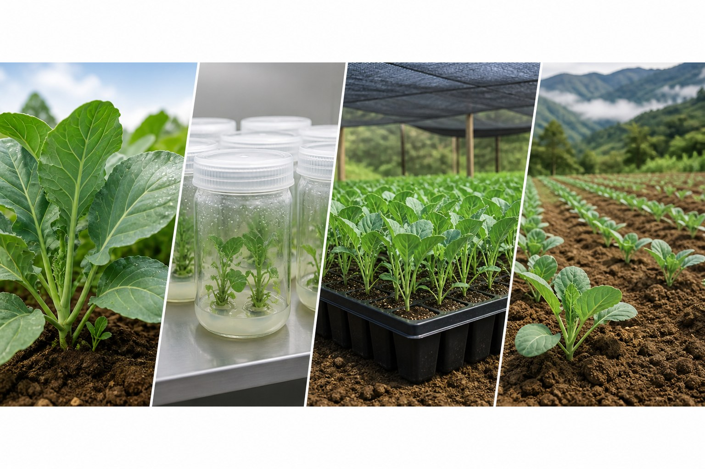
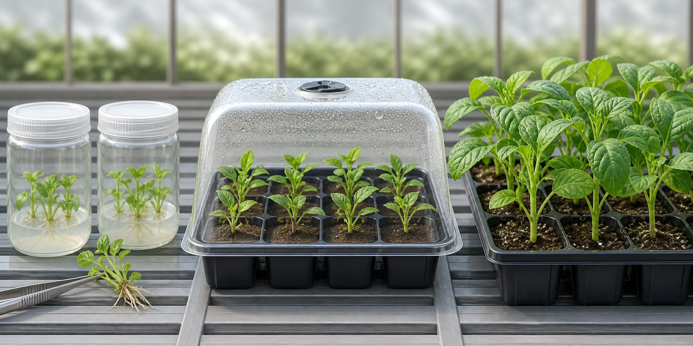
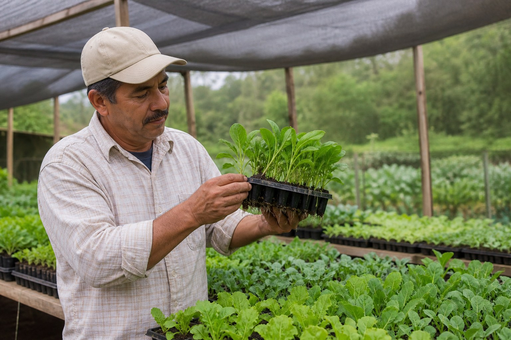
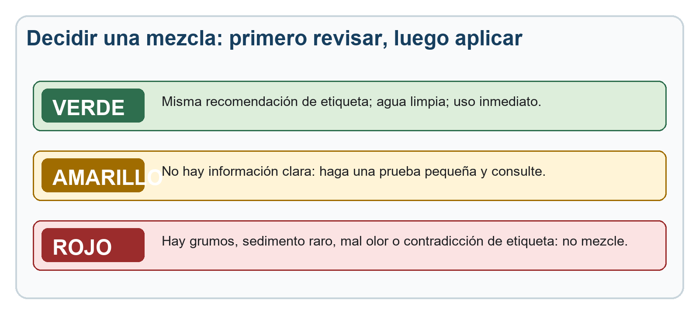

# Fuente — cap02

- **Docente:** <completar>
- **Ingerido:** 2026-11-11
- **Archivos:** material-siembra-elite.pptx

> Transcripcion fiel del material entregado. No editar para estilo: la redaccion didactica se hace en `02-libro.md`.
>
> Las imagenes se guardaron en `diseno/assets/cap02/` y aparecen abajo con su ruta ya lista para pegar en un bloque `:::figura`.

---

# Archivo: material-siembra-elite.pptx

## Diapositiva 1

GUÍA EDUCATIVA

Material de siembra élite
y semilla artificial

Cómo escoger, recibir, manejar y evaluar material de alta calidad

Productores agrícolas y extensionistas del MAG

CIB · Tecnológico de Costa Rica

Con financiamiento de la Dirección de Extensión

> **Notas del docente:** Presente el propósito práctico: tomar mejores decisiones desde la compra del material hasta los primeros 30 días de establecimiento.

[Sources]
- https://www.tec.ac.cr/en/manual-identidad-institucional-guia-rapida
- https://www.tec.ac.cr/sites/default/files/media/doc/logotec.pdf
- https://www.tec.ac.cr/system/files/styles/main_image/private/media/img/main/logo-2.jpg.webp?itok=Worn4o0Q
- https://www.tec.ac.cr/direccion-extension
- https://www.tec.ac.cr/centro-investigacion-biotecnologia-cib
- https://www.fao.org/family-farming/detail/es/c/1733780/
- https://www.mag.go.cr/bibliotecavirtual/f01-10918.pdf
[/Sources]

## Diapositiva 2

GUÍA DE CAMPO

Con financiamiento de la Dirección de Extensión del Tecnológico de Costa Rica

02

El material de siembra cambia el punto de partida

No sustituye el manejo, pero sí puede reducir una desventaja que nace antes de sembrar.

1

Material conocido

Variedad o clon, origen y lote.

2

Mejor arranque

Vigor, sanidad y adaptación.

3

Menos reposición

Menos pérdidas y trabajo repetido.

4

Cosecha más uniforme

Más facilidad para planificar y vender.

Idea central

La mejor semilla no corrige drenaje, riego, nutrición o sanidad mal manejados.

GUÍA DE CAMPO

Con financiamiento de la Dirección de Extensión del Tecnológico de Costa Rica

02

  <!-- repetida en el material (logo o plantilla?) -->

  <!-- repetida en el material (logo o plantilla?) -->

  <!-- repetida en el material (logo o plantilla?) -->

  <!-- repetida en el material (logo o plantilla?) -->

> **Notas del docente:** Explique que el material élite reduce riesgos de partida, pero no es una solución automática. Pida un ejemplo de una siembra que falló por causas ajenas a la semilla.

[Sources]
- https://www.tec.ac.cr/en/manual-identidad-institucional-guia-rapida
- https://www.tec.ac.cr/sites/default/files/media/doc/logotec.pdf
- https://www.tec.ac.cr/system/files/styles/main_image/private/media/img/main/logo-2.jpg.webp?itok=Worn4o0Q
- https://www.fao.org/family-farming/detail/es/c/1733780/
- https://www.fao.org/family-farming/detail/es/c/1674705/
- https://www.mag.go.cr/bibliotecavirtual/f01-10918.pdf
[/Sources]

## Diapositiva 3

GUÍA DE CAMPO

Con financiamiento de la Dirección de Extensión del Tecnológico de Costa Rica

03

Cuatro filtros antes de aceptar un lote

Si uno falla, la decisión debe ser separar, consultar o probar en pequeño.

No basta con que se vea verde

Una planta puede lucir bien y tener identidad dudosa, raíces dañadas o trazabilidad incompleta.

La pregunta correcta

¿Qué es, de dónde viene, cómo se produjo y qué debo hacer al recibirlo?

GUÍA DE CAMPO

Con financiamiento de la Dirección de Extensión del Tecnológico de Costa Rica

03

  <!-- repetida en el material (logo o plantilla?) -->

  <!-- repetida en el material (logo o plantilla?) -->

  <!-- repetida en el material (logo o plantilla?) -->

  <!-- repetida en el material (logo o plantilla?) -->

> **Notas del docente:** Haga que el grupo aplique los cuatro filtros a una bandeja, bolsa de semilla o lote de estacas que conozca.

[Sources]
- https://www.tec.ac.cr/en/manual-identidad-institucional-guia-rapida
- https://www.tec.ac.cr/sites/default/files/media/doc/logotec.pdf
- https://www.tec.ac.cr/system/files/styles/main_image/private/media/img/main/logo-2.jpg.webp?itok=Worn4o0Q
- https://www.fao.org/family-farming/detail/es/c/1674705/
- https://www.mag.go.cr/bibliotecavirtual/f01-10918.pdf
[/Sources]

## Diapositiva 4

GUÍA DE CAMPO

Con financiamiento de la Dirección de Extensión del Tecnológico de Costa Rica

04

No todo material de siembra se maneja igual

El tipo de material cambia los riesgos, el transporte y la forma de comprobar calidad.

Sexual

Semillas producidas por la planta

Vigile: Germinación, pureza, humedad y fecha

Vegetativo

Tubérculos, estacas, esquejes, hijuelos

Vigile: Sanidad, heridas, mezcla de clones y transporte

In vitro

Plántulas micropropagadas

Vigile: Aclimatación, trazabilidad y respaldo sanitario

Artificial

Propágulos encapsulados

Vigile: Viabilidad, protocolo, almacenamiento y evidencia

GUÍA DE CAMPO

Con financiamiento de la Dirección de Extensión del Tecnológico de Costa Rica

04

  <!-- repetida en el material (logo o plantilla?) -->

  <!-- repetida en el material (logo o plantilla?) -->

  <!-- repetida en el material (logo o plantilla?) -->

  <!-- repetida en el material (logo o plantilla?) -->

> **Notas del docente:** Aclare que la palabra semilla se usa en finca para materiales muy distintos. En materiales vegetativos se mueve tejido vivo y también puede moverse una enfermedad.

[Sources]
- https://www.tec.ac.cr/en/manual-identidad-institucional-guia-rapida
- https://www.tec.ac.cr/sites/default/files/media/doc/logotec.pdf
- https://www.tec.ac.cr/system/files/styles/main_image/private/media/img/main/logo-2.jpg.webp?itok=Worn4o0Q
- https://www.fao.org/family-farming/detail/es/c/1733780/
- https://repositorio.inia.gob.pe/bitstreams/bdfa8876-da76-46b6-b3ab-dcf07da202d9/download
- https://www.fao.org/4/y2775s/y2775s0d.htm
[/Sources]

## Diapositiva 5

GUÍA DE CAMPO

Con financiamiento de la Dirección de Extensión del Tecnológico de Costa Rica

05

La ruta del material élite debe poder rastrearse

Cada etapa agrega valor solo si conserva identidad, sanidad y registros.

1

Planta madre

Identidad y desempeño conocidos

2

Verificación

Selección y respaldo sanitario

3

Multiplicación

Protocolo limpio y trazable

4

Aclimatación

Adaptación gradual en vivero

5

Finca

Prueba, registro y decisión

Si se pierde la etiqueta o se mezclan lotes, se pierde parte del valor del material élite.

GUÍA DE CAMPO

Con financiamiento de la Dirección de Extensión del Tecnológico de Costa Rica

05

  <!-- repetida en el material (logo o plantilla?) -->

  <!-- repetida en el material (logo o plantilla?) -->

  <!-- repetida en el material (logo o plantilla?) -->

  <!-- repetida en el material (logo o plantilla?) -->

> **Notas del docente:** Use la ruta para explicar por qué la trazabilidad no es papeleo: permite saber dónde se originó una diferencia y qué lote debe seguirse.

[Sources]
- https://www.tec.ac.cr/en/manual-identidad-institucional-guia-rapida
- https://www.tec.ac.cr/sites/default/files/media/doc/logotec.pdf
- https://www.tec.ac.cr/system/files/styles/main_image/private/media/img/main/logo-2.jpg.webp?itok=Worn4o0Q
- https://www.tec.ac.cr/centro-investigacion-biotecnologia-cib
- https://repositorio.inia.gob.pe/bitstreams/bdfa8876-da76-46b6-b3ab-dcf07da202d9/download
- https://www.fao.org/family-farming/detail/es/c/1733780/
[/Sources]

## Diapositiva 6

GUÍA DE CAMPO

Con financiamiento de la Dirección de Extensión del Tecnológico de Costa Rica

06

Cultivo in vitro: una herramienta, no una garantía

Su valor depende del protocolo, la sanidad y el manejo después de salir del laboratorio.

✓

Sí puede aportar

Multiplicación rápida de material seleccionado

Mayor uniformidad si el proceso se controla

Apoyo al saneamiento y conservación

Producción en poco espacio

!

No garantiza

Que toda planta esté libre de todo problema

Supervivencia sin aclimatación

Buen resultado con riego o suelo deficientes

Rentabilidad sin una prueba de finca

GUÍA DE CAMPO

Con financiamiento de la Dirección de Extensión del Tecnológico de Costa Rica

06

  <!-- repetida en el material (logo o plantilla?) -->

  <!-- repetida en el material (logo o plantilla?) -->

  <!-- repetida en el material (logo o plantilla?) -->

  <!-- repetida en el material (logo o plantilla?) -->

> **Notas del docente:** Sea directo: in vitro describe cómo se produjo el material, no un resultado garantizado en campo. Pregunte qué protocolo de aclimatación acompaña la entrega.

[Sources]
- https://www.tec.ac.cr/en/manual-identidad-institucional-guia-rapida
- https://www.tec.ac.cr/sites/default/files/media/doc/logotec.pdf
- https://www.tec.ac.cr/system/files/styles/main_image/private/media/img/main/logo-2.jpg.webp?itok=Worn4o0Q
- https://repositorio.inia.gob.pe/bitstreams/bdfa8876-da76-46b6-b3ab-dcf07da202d9/download
- https://www.fao.org/4/aj431s/aj431s.pdf
[/Sources]

## Diapositiva 7

GUÍA DE CAMPO

Con financiamiento de la Dirección de Extensión del Tecnológico de Costa Rica

07

Aclimatación: pasar de un ambiente protegido a uno real

El cambio debe ser gradual; la mortalidad temprana suele indicar que algo se aceleró o se saturó.

1

Sombra y humedad alta

Evitar pérdida rápida de agua.

2

Menos protección, poco a poco

No retirar el domo de golpe.

3

Riego sin encharcar

Raíces necesitan agua y aire.

4

Planta firme antes del campo

Raíces activas y crecimiento nuevo.

GUÍA DE CAMPO

Con financiamiento de la Dirección de Extensión del Tecnológico de Costa Rica

07

  <!-- repetida en el material (logo o plantilla?) -->

  <!-- repetida en el material (logo o plantilla?) -->

  <!-- repetida en el material (logo o plantilla?) -->

  <!-- repetida en el material (logo o plantilla?) -->

> **Notas del docente:** Explique que una planta in vitro tiene que ajustar su regulación de agua y su funcionamiento fuera del frasco. La adaptación se observa y se registra cada día.

[Sources]
- https://www.tec.ac.cr/en/manual-identidad-institucional-guia-rapida
- https://www.tec.ac.cr/sites/default/files/media/doc/logotec.pdf
- https://www.tec.ac.cr/system/files/styles/main_image/private/media/img/main/logo-2.jpg.webp?itok=Worn4o0Q
- https://repositorio.inia.gob.pe/bitstreams/bdfa8876-da76-46b6-b3ab-dcf07da202d9/download
- https://www.fao.org/4/aj431s/aj431s.pdf
[/Sources]

## Diapositiva 8

GUÍA DE CAMPO

Con financiamiento de la Dirección de Extensión del Tecnológico de Costa Rica

08

La recepción es un control de calidad, no un trámite

Revise antes de sembrar: después será más difícil separar el problema del manejo de la finca.

Cinco preguntas al abrir el lote

1

¿Corresponde a la variedad o clon solicitado?

2

¿Tiene lote, fecha, proveedor y cantidad?

3

¿Llega firme, sin olor raro ni pudrición?

4

¿Las raíces y el sustrato están en condición adecuada?

5

¿Hay plantas que deben separarse y fotografiarse?

Separar no significa desechar: significa no mezclar hasta aclarar.

GUÍA DE CAMPO

Con financiamiento de la Dirección de Extensión del Tecnológico de Costa Rica

08

  <!-- repetida en el material (logo o plantilla?) -->

  <!-- repetida en el material (logo o plantilla?) -->

  <!-- repetida en el material (logo o plantilla?) -->

  <!-- repetida en el material (logo o plantilla?) -->

> **Notas del docente:** Pida que una persona haga la revisión en voz alta. La presión por sembrar el mismo día no debe eliminar la verificación del lote.

[Sources]
- https://www.tec.ac.cr/en/manual-identidad-institucional-guia-rapida
- https://www.tec.ac.cr/sites/default/files/media/doc/logotec.pdf
- https://www.tec.ac.cr/system/files/styles/main_image/private/media/img/main/logo-2.jpg.webp?itok=Worn4o0Q
- https://www.fao.org/family-farming/detail/es/c/1674705/
- https://www.mag.go.cr/bibliotecavirtual/f01-10918.pdf
- https://www.fao.org/family-farming/detail/es/c/1733780/
[/Sources]

## Diapositiva 9

GUÍA DE CAMPO

Con financiamiento de la Dirección de Extensión del Tecnológico de Costa Rica

09

Primeros 30 días: la historia del establecimiento

No espere a la cosecha para descubrir que el lote perdió plantas o uniformidad.

1

Día 0

Lote, cantidad, sector y foto inicial

2

Día 7

Plantas vivas, marchitez y reposición

3

Día 14

Uniformidad, crecimiento y sanidad

4

Día 21

Raíces, humedad y acciones tomadas

5

Día 30

Prendimiento y decisión de escalar

Prendimiento (%) = plantas vivas ÷ plantas sembradas × 100

GUÍA DE CAMPO

Con financiamiento de la Dirección de Extensión del Tecnológico de Costa Rica

09

  <!-- repetida en el material (logo o plantilla?) -->

  <!-- repetida en el material (logo o plantilla?) -->

  <!-- repetida en el material (logo o plantilla?) -->

  <!-- repetida en el material (logo o plantilla?) -->

> **Notas del docente:** Defina una misma fecha de conteo para poder comparar lotes. Una foto ayuda, pero no reemplaza el número de plantas vivas.

[Sources]
- https://www.tec.ac.cr/en/manual-identidad-institucional-guia-rapida
- https://www.tec.ac.cr/sites/default/files/media/doc/logotec.pdf
- https://www.tec.ac.cr/system/files/styles/main_image/private/media/img/main/logo-2.jpg.webp?itok=Worn4o0Q
- https://www.fao.org/family-farming/detail/es/c/1733780/
- https://www.mag.go.cr/bibliotecavirtual/f01-10918.pdf
[/Sources]

## Diapositiva 10

GUÍA DE CAMPO

Con financiamiento de la Dirección de Extensión del Tecnológico de Costa Rica

10

Semilla artificial: un propágulo encapsulado

Es una tecnología específica; no es una semilla sexual pintada ni un producto universal para cualquier cultivo.

Propágulo
vivo

Matriz protectora

Capa de encapsulación

Qué busca

Facilitar el manejo, la siembra o la conservación de embriones somáticos u otros propágulos, según la especie y el protocolo.

Qué debe demostrarse

Viabilidad, capacidad de germinar o convertirse en planta, almacenamiento, sanidad, costo y establecimiento en condiciones reales.

GUÍA DE CAMPO

Con financiamiento de la Dirección de Extensión del Tecnológico de Costa Rica

10

  <!-- repetida en el material (logo o plantilla?) -->

  <!-- repetida en el material (logo o plantilla?) -->

  <!-- repetida en el material (logo o plantilla?) -->

  <!-- repetida en el material (logo o plantilla?) -->

> **Notas del docente:** Defina semilla artificial con precisión: es un embrión somático u otro propágulo encapsulado o revestido que se maneja como semilla. Subraye que la tecnología sigue dependiendo mucho de la especie y el protocolo.

[Sources]
- https://www.tec.ac.cr/en/manual-identidad-institucional-guia-rapida
- https://www.tec.ac.cr/sites/default/files/media/doc/logotec.pdf
- https://www.tec.ac.cr/system/files/styles/main_image/private/media/img/main/logo-2.jpg.webp?itok=Worn4o0Q
- https://www.fao.org/4/y2775s/y2775s0d.htm
- https://www.fao.org/4/aj431s/aj431s.pdf
[/Sources]

## Diapositiva 11

GUÍA DE CAMPO

Con financiamiento de la Dirección de Extensión del Tecnológico de Costa Rica

11

Material preinoculado: microorganismos vivos con un objetivo

El producto puede ayudar, pero su viabilidad y respuesta cambian con almacenamiento, agua, suelo, cultivo y manejo.

1

Producto correcto

Cultivo, objetivo, lote y vencimiento

2

Preparación limpia

Agua, equipo, dosis y tiempo

3

Aplicación oportuna

Raíz, semilla o sustrato según etiqueta

4

Verificación

Testigo, registro y seguimiento

No atribuya todo el resultado al inoculante. Registre también suelo, riego, fertilización, clima y calidad del material.

GUÍA DE CAMPO

Con financiamiento de la Dirección de Extensión del Tecnológico de Costa Rica

11

  <!-- repetida en el material (logo o plantilla?) -->

  <!-- repetida en el material (logo o plantilla?) -->

  <!-- repetida en el material (logo o plantilla?) -->

  <!-- repetida en el material (logo o plantilla?) -->

> **Notas del docente:** Recuerde que se trabaja con organismos vivos o latentes. La fuente, dosis, momento y lugar correctos deben acompañarse de almacenamiento y equipo adecuados.

[Sources]
- https://www.tec.ac.cr/en/manual-identidad-institucional-guia-rapida
- https://www.tec.ac.cr/sites/default/files/media/doc/logotec.pdf
- https://www.tec.ac.cr/system/files/styles/main_image/private/media/img/main/logo-2.jpg.webp?itok=Worn4o0Q
- https://capacitacion.fao.org/theme/continuum/infocourse.php?course=221
- https://bio-emprender.iica.int/iica-tools/microbiologia-aplicada-a-los-bioinsumos/
[/Sources]

## Diapositiva 12

GUÍA DE CAMPO

Con financiamiento de la Dirección de Extensión del Tecnológico de Costa Rica

12

Compatibilidad: primero revisar, después mezclar

Que una mezcla no forme grumos no demuestra que el microorganismo siga vivo ni que la planta la tolere.

1. Etiqueta

¿Autoriza la mezcla y explica el orden?

2. Agua y equipo

¿Están limpios y sin residuos previos?

3. Uso inmediato

¿Se aplicará sin sol, calor o espera innecesaria?

GUÍA DE CAMPO

Con financiamiento de la Dirección de Extensión del Tecnológico de Costa Rica

12

  <!-- repetida en el material (logo o plantilla?) -->

  <!-- repetida en el material (logo o plantilla?) -->

  <!-- repetida en el material (logo o plantilla?) -->

  <!-- repetida en el material (logo o plantilla?) -->

> **Notas del docente:** Use el semáforo para detener mezclas improvisadas. La prueba de frasco solo detecta ciertos problemas físicos y no reemplaza la etiqueta ni una prueba sobre plantas.

[Sources]
- https://www.tec.ac.cr/en/manual-identidad-institucional-guia-rapida
- https://www.tec.ac.cr/sites/default/files/media/doc/logotec.pdf
- https://www.tec.ac.cr/system/files/styles/main_image/private/media/img/main/logo-2.jpg.webp?itok=Worn4o0Q
- https://capacitacion.fao.org/theme/continuum/infocourse.php?course=221
- https://bio-emprender.iica.int/iica-tools/microbiologia-aplicada-a-los-bioinsumos/
[/Sources]

## Diapositiva 13

GUÍA DE CAMPO

Con financiamiento de la Dirección de Extensión del Tecnológico de Costa Rica

13

Trasplante: proteger raíces, humedad y tiempo

Un material de alta calidad puede perderse en minutos por sol, viento, golpes o profundidad incorrecta.

1

Prepare la cama y el riego antes de sacar las plantas.

2

Tome la plántula por el cepellón, no por el tallo.

3

Evite raíces expuestas al sol y al viento.

4

Siembre a profundidad adecuada, sin compactar de más.

5

Revise el lote en las horas siguientes y registre pérdidas.

GUÍA DE CAMPO

Con financiamiento de la Dirección de Extensión del Tecnológico de Costa Rica

13

  <!-- repetida en el material (logo o plantilla?) -->

  <!-- repetida en el material (logo o plantilla?) -->

  <!-- repetida en el material (logo o plantilla?) -->

  <!-- repetida en el material (logo o plantilla?) -->

> **Notas del docente:** Muestre físicamente cómo sostener el cepellón. Verifique que el terreno y el agua estén listos antes de exponer las plantas fuera de la sombra.

[Sources]
- https://www.tec.ac.cr/en/manual-identidad-institucional-guia-rapida
- https://www.tec.ac.cr/sites/default/files/media/doc/logotec.pdf
- https://www.tec.ac.cr/system/files/styles/main_image/private/media/img/main/logo-2.jpg.webp?itok=Worn4o0Q
- https://www.fao.org/family-farming/detail/es/c/1733780/
- https://www.mag.go.cr/bibliotecavirtual/f01-10918.pdf
[/Sources]

## Diapositiva 14

GUÍA DE CAMPO

Con financiamiento de la Dirección de Extensión del Tecnológico de Costa Rica

14

La decisión económica no se toma con el precio de compra

Compare el costo completo y el resultado comercial del material habitual frente al nuevo.

Ingreso comercial

Producción vendida
×
Precio recibido

−

Costos directos

Material y transporte
Reposición
Insumos
Mano de obra

=

Resultado

Margen
y riesgo

Margen bruto = ingreso por producción comercial − costos directos

Las pérdidas evitadas pueden aumentar la producción vendida y reducir reposición. Compare con un testigo.

GUÍA DE CAMPO

Con financiamiento de la Dirección de Extensión del Tecnológico de Costa Rica

14

  <!-- repetida en el material (logo o plantilla?) -->

  <!-- repetida en el material (logo o plantilla?) -->

  <!-- repetida en el material (logo o plantilla?) -->

  <!-- repetida en el material (logo o plantilla?) -->

> **Notas del docente:** Insista en que un material más caro puede convenir si reduce reposición o mejora producción comercial, pero eso debe medirse en una parcela comparable.

[Sources]
- https://www.tec.ac.cr/en/manual-identidad-institucional-guia-rapida
- https://www.tec.ac.cr/sites/default/files/media/doc/logotec.pdf
- https://www.tec.ac.cr/system/files/styles/main_image/private/media/img/main/logo-2.jpg.webp?itok=Worn4o0Q
- https://www.fao.org/family-farming/detail/es/c/1733780/
- https://capacitacion.fao.org/theme/continuum/infocourse.php?course=221
[/Sources]

## Diapositiva 15

TIPS PRÁCTICOS

Con financiamiento de la Dirección de Extensión del Tecnológico de Costa Rica

15

Tips para productores

Ocho hábitos que protegen la inversión desde la compra hasta la evaluación.

1

Defina lo que necesita

Cultivo, variedad, cantidad y fecha.

2

Pida lote y procedencia

No compre solo por apariencia.

3

Prepare la recepción

Sombra, agua, etiquetas y separación.

4

Revise antes de sembrar

Hojas, tallos, raíces y uniformidad.

5

No mezcle material dudoso

Separe, fotografíe y consulte.

6

Siga la etiqueta

Dosis, agua, mezcla y almacenamiento.

7

Pruebe en pequeño

Mantenga un testigo comparable.

8

Anote y cuente

Prendimiento, costos y resultado comercial.

TIPS PRÁCTICOS

Con financiamiento de la Dirección de Extensión del Tecnológico de Costa Rica

15

  <!-- repetida en el material (logo o plantilla?) -->

  <!-- repetida en el material (logo o plantilla?) -->

  <!-- repetida en el material (logo o plantilla?) -->

  <!-- repetida en el material (logo o plantilla?) -->

> **Notas del docente:** No lea todos los tips. Pida que cada productor elija dos hábitos que puede aplicar en su siguiente compra o trasplante.

[Sources]
- https://www.tec.ac.cr/en/manual-identidad-institucional-guia-rapida
- https://www.tec.ac.cr/sites/default/files/media/doc/logotec.pdf
- https://www.tec.ac.cr/system/files/styles/main_image/private/media/img/main/logo-2.jpg.webp?itok=Worn4o0Q
- https://www.fao.org/family-farming/detail/es/c/1674705/
- https://www.mag.go.cr/bibliotecavirtual/f01-10918.pdf
- https://capacitacion.fao.org/theme/continuum/infocourse.php?course=221
[/Sources]

## Diapositiva 16

TIPS PARA EXTENSIÓN

Con financiamiento de la Dirección de Extensión del Tecnológico de Costa Rica

16

Tips para extensionistas

La recomendación debe terminar en una decisión verificable, no en una promesa tecnológica.

1

Parta de la decisión

Comprar, aceptar, separar, probar o descartar.

2

Separe observación y diagnóstico

Un síntoma o foto no confirma la causa.

3

Explique límites

In vitro, semilla artificial y bioinsumos no son automáticos.

4

Haga trazable la recomendación

Lote, fecha, tratamiento y ubicación.

5

Demuestre y compruebe

Que la persona repita el procedimiento.

6

Incluya un testigo

Condiciones comparables y pocos indicadores.

7

Documente incertidumbres

Defina qué dato falta antes de escalar.

8

Cierre con seguimiento

Acción, responsable, fecha y dato a revisar.

TIPS PARA EXTENSIÓN

Con financiamiento de la Dirección de Extensión del Tecnológico de Costa Rica

16

  <!-- repetida en el material (logo o plantilla?) -->

  <!-- repetida en el material (logo o plantilla?) -->

  <!-- repetida en el material (logo o plantilla?) -->

  <!-- repetida en el material (logo o plantilla?) -->

> **Notas del docente:** Use estos tips como estándar mínimo de una visita. Una recomendación profesional debe declarar límites y dejar un seguimiento medible.

[Sources]
- https://www.tec.ac.cr/en/manual-identidad-institucional-guia-rapida
- https://www.tec.ac.cr/sites/default/files/media/doc/logotec.pdf
- https://www.tec.ac.cr/system/files/styles/main_image/private/media/img/main/logo-2.jpg.webp?itok=Worn4o0Q
- https://www.tec.ac.cr/direccion-extension
- https://capacitacion.fao.org/theme/continuum/infocourse.php?course=221
- https://repositorio.inia.gob.pe/bitstreams/bdfa8876-da76-46b6-b3ab-dcf07da202d9/download
[/Sources]

## Diapositiva 17

DISCUSIÓN TÉCNICA

Con financiamiento de la Dirección de Extensión del Tecnológico de Costa Rica

17

Desafíos para que la tecnología funcione en la finca

Estos desafíos se incluyen en la presentación para orientar discusión, planificación y seguimiento.

1

Confianza y adopción

Demostrar sin exagerar y respetar el conocimiento local.

2

Trazabilidad

Mantener identidad del lote desde la planta madre hasta el campo.

3

Aclimatación

Contar con vivero, agua, sombra y seguimiento suficientes.

4

Compatibilidad

Evitar que mezclas y almacenamiento maten microorganismos útiles.

5

Evidencia económica

Medir costos, pérdidas y resultado antes de escalar.

DISCUSIÓN TÉCNICA

Con financiamiento de la Dirección de Extensión del Tecnológico de Costa Rica

17

  <!-- repetida en el material (logo o plantilla?) -->

  <!-- repetida en el material (logo o plantilla?) -->

  <!-- repetida en el material (logo o plantilla?) -->

  <!-- repetida en el material (logo o plantilla?) -->

> **Notas del docente:** Abra la discusión: ¿cuál desafío es más fuerte en la zona y qué acción puede reducirlo? No permita que el grupo convierta una limitación técnica en una descalificación total de la tecnología.

[Sources]
- https://www.tec.ac.cr/en/manual-identidad-institucional-guia-rapida
- https://www.tec.ac.cr/sites/default/files/media/doc/logotec.pdf
- https://www.tec.ac.cr/system/files/styles/main_image/private/media/img/main/logo-2.jpg.webp?itok=Worn4o0Q
- https://www.tec.ac.cr/direccion-extension
- https://www.tec.ac.cr/centro-investigacion-biotecnologia-cib
- https://capacitacion.fao.org/theme/continuum/infocourse.php?course=221
- https://repositorio.inia.gob.pe/bitstreams/bdfa8876-da76-46b6-b3ab-dcf07da202d9/download
- https://www.fao.org/4/aj431s/aj431s.pdf
[/Sources]

## Diapositiva 18

La próxima siembra puede empezar mejor

Cinco acciones para aplicar la guía

1

Definir el material que realmente necesita la finca.

2

Exigir identidad, sanidad y trazabilidad.

3

Revisar y separar antes de sembrar.

4

Probar en pequeño con un testigo.

5

Registrar a los 7, 14 y 30 días y decidir con datos.

Recursos educativos en español

MAG · Semilla certificada

INIA · Micropropagación

FAO · Curso de bioinsumos

CIB · Tecnológico de Costa Rica

Con financiamiento de la Dirección de Extensión

Gracias

  <!-- repetida en el material (logo o plantilla?) -->

  <!-- repetida en el material (logo o plantilla?) -->

> **Notas del docente:** Cierre pidiendo un compromiso concreto: qué dato, revisión o prueba realizará cada participante en su siguiente ciclo. Los tres recursos visibles son enlaces educativos en español.

[Sources]
- https://www.tec.ac.cr/en/manual-identidad-institucional-guia-rapida
- https://www.tec.ac.cr/sites/default/files/media/doc/logotec.pdf
- https://www.tec.ac.cr/system/files/styles/main_image/private/media/img/main/logo-2.jpg.webp?itok=Worn4o0Q
- https://www.tec.ac.cr/direccion-extension
- https://www.tec.ac.cr/centro-investigacion-biotecnologia-cib
- https://www.mag.go.cr/bibliotecavirtual/f01-10918.pdf
- https://repositorio.inia.gob.pe/bitstreams/bdfa8876-da76-46b6-b3ab-dcf07da202d9/download
- https://capacitacion.fao.org/theme/continuum/infocourse.php?course=221
[/Sources]
