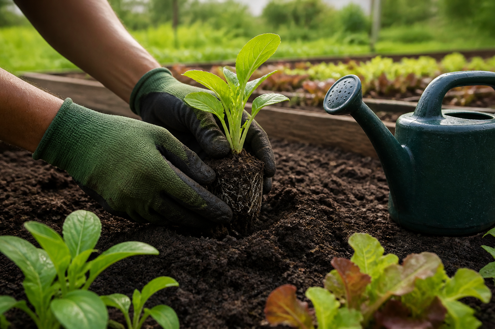
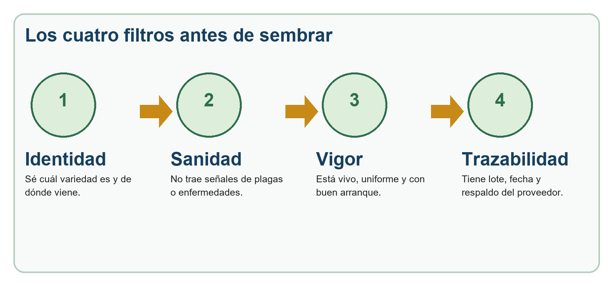
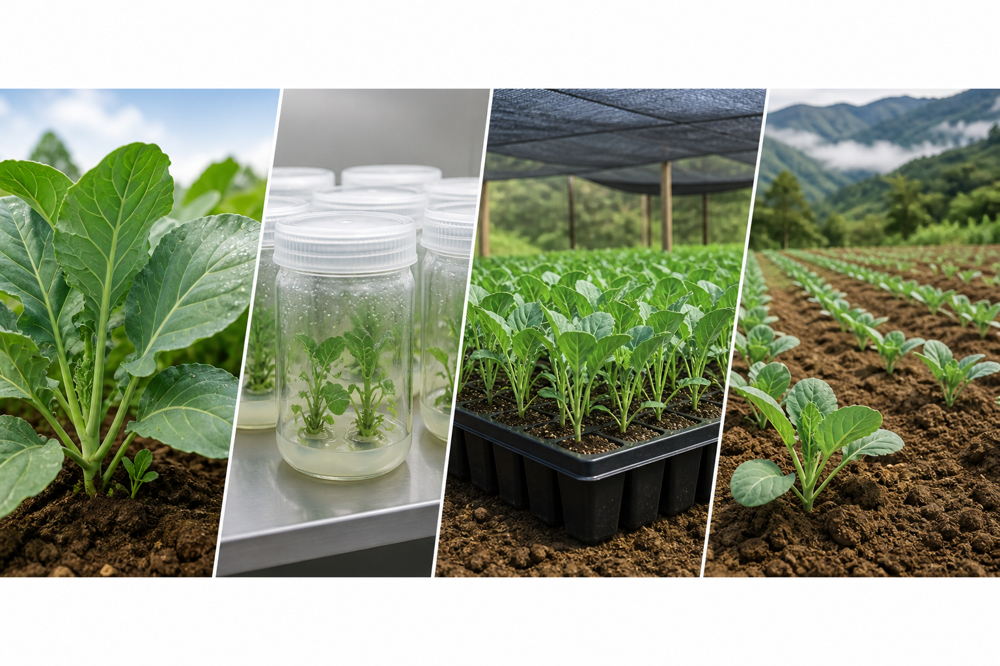

# Fuente — cap02

- **Docente:** <completar>
- **Ingerido:** 2026-11-11
- **Archivos:** guia-material-siembra-elite.docx, material-siembra-elite.pptx

> Transcripcion fiel del material entregado. No editar para estilo: la redaccion didactica se hace en `02-libro.md`.
>
> Las imagenes se guardaron en `diseno/assets/cap02/` y aparecen abajo con su ruta ya lista para pegar en un bloque `:::figura`.

---

# Archivo: guia-material-siembra-elite.docx

GUÍA DE CAMPO

Material de siembra élite
y semilla artificial

Cómo escoger, recibir, manejar y evaluar material de siembra de alta calidad

De una planta madre sana a una siembra con mejor arranque.

Con financiamiento de la Dirección de Extensión del Tecnológico de Costa Rica

Cartago, Costa Rica | Versión de trabajo 2026

## Cómo usar esta guía

Esta guía sirve para tomar decisiones en la finca y para apoyar una capacitación. No sustituye el diagnóstico fitosanitario, la recomendación profesional ni la etiqueta de un producto registrado.

### Recorrido de la guía

## 1. Material de siembra élite: el buen comienzo

En esta guía, llamamos material de siembra élite al material vegetal que se escoge y multiplica porque tiene una identidad conocida, buen desempeño y buen estado sanitario. Puede ser semilla sexual, tubérculo, plántula, esqueje, estaca o planta producida in vitro. No significa que sea “milagroso”: su resultado depende también del manejo de la finca.

### 1.1 ¿Por qué importa?

Figura 1. Los cuatro filtros básicos de calidad antes de sembrar.

### 1.2 Origen: cultivo in vitro y selección clonal

El cultivo in vitro se hace en condiciones limpias y controladas. A partir de una parte pequeña de una planta seleccionada se multiplican plantas jóvenes. La selección clonal consiste en escoger una planta madre que ha mostrado las características deseadas y multiplicarla de forma vegetativa.

#### Ruta recomendada

- Definir la variedad o clon que se necesita para la zona y el mercado.

- Confirmar procedencia, condición sanitaria y trazabilidad del lote.

- Recibir el material sin exponerlo al sol, deshidratación o contaminación.

- Aclimatar y establecer un lote pequeño de observación antes de escalar.

- Registrar supervivencia, uniformidad y problemas; decidir con esos datos.

### 1.3 Calidad sanitaria del material

La calidad sanitaria significa reducir el riesgo de llevar plagas o enfermedades desde la siembra. Observe hojas, tallos, raíces, tubérculos y sustrato. Aísle cualquier material dudoso y no lo use para multiplicar.

☐ El lote está identificado: especie, variedad o clon, proveedor, fecha y número de lote.

☐ Las plantas llegan firmes, sin marchitez fuerte, pudriciones, lesiones extrañas ni presencia visible de insectos.

☐ El embalaje protege las plantas de golpes y exceso de calor; no llega con agua estancada ni olor a descomposición.

☐ Se cuenta con respaldo técnico o documento de origen cuando el proveedor lo ofrece.

☐ El material que genera duda se mantiene separado hasta recibir criterio técnico.

## 2. Semilla artificial: una tecnología que hay que entender bien

La semilla artificial no es una semilla común producida por una flor. Es una estructura preparada para proteger y transportar un propágulo vegetal, por ejemplo un embrión somático o una yema, dentro de una cápsula. Puede incluir nutrientes o protectores. En muchos cultivos sigue siendo una tecnología de laboratorio o de desarrollo, no un reemplazo general de la semilla comercial.

### 1.4 Concepto y usos reales

### 1.5 Ventajas y limitaciones en campo

#### Regla práctica

Antes de usar semilla artificial a escala comercial, pida resultados de supervivencia, uniformidad y rendimiento en condiciones similares a su finca. Empiece con una parcela demostrativa y compare contra el material que ya utiliza.

### 1.6 Material preinoculado con microorganismos benéficos

Preinocular es aplicar microorganismos benéficos al material de siembra antes de sembrar o trasplantar. El objetivo puede ser favorecer el establecimiento, la disponibilidad de nutrientes o la competencia frente a algunos patógenos. El efecto no está garantizado: depende del organismo, la dosis, la humedad, el sustrato, la temperatura y el manejo.

## 3. Manejo en finca: donde se gana o se pierde el valor

### 1.7 Errores comunes y cómo evitarlos

### 1.8 Compatibilidad con fertilización y biocontrol

No existe una mezcla “siempre segura”. La compatibilidad se define por el producto, la concentración, el agua, el tiempo de contacto y el cultivo. Como práctica de manejo, la etiqueta y la recomendación técnica tienen prioridad.

Figura 2. Criterio simple para decidir antes de mezclar o aplicar.

#### Prueba de compatibilidad en frasco: solo cuando tenga sentido

- Use un frasco limpio y agua de la misma fuente que se empleará en la aplicación.

- Agregue los productos en proporción equivalente y respete el orden que indique la etiqueta.

- Observe por 15 a 30 minutos: grumos, separación marcada, precipitados, calentamiento o espuma anormal son señales de alerta.

- La prueba de frasco no confirma que sea seguro para la planta o para el microorganismo. Si hay duda, no mezcle y consulte.

### 1.9 Evaluación económica: ¿vale la pena?

La decisión no debe basarse solo en el precio por unidad. Compare el costo total y el resultado por área. Incluya sobrevivencia, uniformidad, mano de obra, pérdidas y el posible ahorro por una mejor sanidad inicial.

## 4. Elegir un buen material: lista final

Use esta lista antes de comprar o recibir material de siembra. Si una respuesta importante es “no” o “no sé”, detenga la decisión y busque respaldo técnico.

### 1.10 Criterios mínimos de selección

☐ Sé qué cultivo, variedad o clon necesito y para qué mercado o condición de finca.

☐ El proveedor puede indicar la procedencia del material y la fecha o número de lote.

☐ El material está uniforme, firme y sin señales visibles de problemas sanitarios.

☐ La presentación, cantidad y estado del material se revisaron antes de firmar la recepción.

☐ Tengo condiciones para recibirlo: sombra, agua de calidad, sustrato, bandejas o sitio de siembra listo.

☐ Conozco el plan de aclimatación o establecimiento y quién dará apoyo técnico si algo falla.

☐ Voy a registrar un área de prueba antes de llevar toda la finca a una tecnología nueva.

☐ Si hay microorganismos asociados, tengo clara la dosis, almacenamiento, vencimiento y compatibilidades.

### Ficha corta de recepción en finca

Sugerencia para extensión: digitalice esta ficha con una fotografía del lote y guárdela junto con los datos de establecimiento y evaluación.

## 5. Materiales para ampliar y conversar en capacitación

Los siguientes recursos están en español y provienen de instituciones públicas, organismos internacionales o centros de investigación. Son útiles para preparar una sesión o responder preguntas. Revise siempre la normativa y los productos registrados que apliquen en Costa Rica.

FAO / AGROSAVIA - Guía de manejo de semillas vegetativas de alta calidad

Explica el manejo de semilla vegetativa limpia a partir de material inicial certificado y técnicas in vitro.

FAO / AGROSAVIA - Selección de semilla y variedades

Recurso breve sobre el valor genético y sanitario de una semilla de calidad.

MAG Costa Rica - Semilla certificada

Ficha técnica costarricense sobre categorías de semilla de yuca y el papel de plantas in vitro.

MAG Costa Rica - Material genético de calidad

Ejemplos nacionales de materiales genéticos y semilla autorizada o certificada.

INTA - Fichas tecnológicas

Catálogo de materiales técnicos, incluidos temas de semilla micropropagada y microorganismos promotores de crecimiento.

INIA Perú - Manual de micropropagación in vitro y semilla prebásica de papa

Material técnico para comprender propagación in vitro, aclimatación y semilla de calidad.

### Glosario en palabras sencillas

Aclimatación: Etapa de adaptación gradual de una planta producida en condiciones protegidas hacia el vivero o campo.

Bioinsumo: Producto de origen biológico usado en la producción agrícola; puede incluir microorganismos, extractos o compuestos naturales.

Clon: Grupo de plantas multiplicadas a partir de una misma planta madre; se busca que mantengan sus características.

Lote: Grupo de material que comparte origen y manejo, identificado para poder rastrearlo.

Micropropagación: Multiplicación de plantas a partir de partes pequeñas, usualmente bajo condiciones de cultivo in vitro.

Propágulo: Parte de una planta que puede originar otra planta: semilla, yema, esqueje, tubérculo u otra estructura.

Trazabilidad: Capacidad de seguir el origen, manejo y destino de un material mediante registros.

Fin del módulo 1 | Material de siembra élite y semilla artificial

## 6. Antes de hablar de élite: cinco calidades que se deben revisar

Una semilla o plántula puede verse bonita y aun así no ser el mejor material. La revisión debe ser completa.

Genética. La variedad o clon es realmente el que se pidió y mantiene características conocidas.

Física. El lote tiene pocas impurezas, daños mecánicos, semillas quebradas o material fuera de tipo.

Fisiológica. Tiene capacidad de germinar o establecerse; está vivo, vigoroso y no envejecido.

Sanitaria. No lleva una carga conocida de plagas o enfermedades que se pueden propagar desde el inicio.

De información. Se conoce el origen, el lote, la fecha, el proveedor y las condiciones de manejo.

### Pregunta para un grupo de productores

Pida a cada participante que recuerde una siembra que arrancó mal. Luego clasifiquen la causa: ¿era un problema de material, de manejo, de clima o de mercado? Esta conversación evita atribuirle todo a la semilla.

## 7. Material sexual y material vegetativo: no se manejan igual

La palabra “semilla” se usa para muchas cosas. En la finca es importante distinguirlas porque los riesgos cambian.

En materiales vegetativos el riesgo de transportar enfermedades es especialmente importante porque se está moviendo una parte viva de una planta. Por eso un lote madre sano, registros y observación constante pesan tanto como la apariencia del material el día de compra.

## 8. Recepción y transporte: las primeras horas importan

Un buen material puede deteriorarse antes de llegar a la finca si se maneja con calor, falta de aire o golpes.

- Prepare el área antes de que llegue el material: sombra, bandejas, agua limpia, sustrato y etiquetas.

- Revise el material a la entrega. Anote cualquier daño, humedad anormal, falta de identificación o diferencia con el pedido.

- No deje cajas o bandejas dentro de un vehículo cerrado. El calor y la falta de ventilación aceleran el estrés.

- Evite el sol directo, pero tampoco mantenga las plantas empapadas sin ventilación. La humedad excesiva favorece problemas sanitarios.

- Separe y fotografíe los lotes con síntomas o dudas. No los mezcle con el lote que sí se va a sembrar.

Imagen referencial. La revisión debe hacerse antes de llevar el material a la parcela.

## 9. Cómo leer el estado de una plántula

No se necesita laboratorio para detectar señales básicas. Lo importante es observar con calma y comparar plantas del mismo lote.

Hojas: Busque color relativamente uniforme, sin manchas extensas, deformaciones repetidas ni marchitez fuerte.

Tallo: Debe estar firme, sin estrangulamientos, pudriciones, heridas profundas o crecimiento desproporcionadamente alargado.

Raíces: Si se puede revisar sin destruir el cepellón, observe raíces claras y activas. Olor desagradable, raíces oscuras blandas o un cepellón saturado son señales de alerta.

Uniformidad: Un lote con tamaños muy distintos no siempre es malo, pero exige preguntar si mezcla edades, variedades o condiciones de manejo.

Sustrato: Debe sostener el cepellón sin estar seco como polvo ni saturado de agua.

### Tres decisiones posibles

Cuando un lote se retiene, no significa que deba descartarse automáticamente. Significa que no se debe plantar ni mezclar hasta identificar la causa y recibir una recomendación técnica.

## 10. Cultivo in vitro: qué aporta y qué no aporta

El cultivo in vitro es una herramienta poderosa, pero pierde valor si se malinterpreta o se maneja mal después de salir del laboratorio.

En un laboratorio se trabaja con partes pequeñas de una planta en condiciones controladas. Esto permite multiplicar material seleccionado en poco espacio y, dependiendo del sistema aplicado, apoyar el saneamiento y la conservación. Para el productor, lo relevante no es aprender a hacer el procedimiento, sino saber qué pedir, cómo recibir el material y cómo aclimatarlo.

### Lo que conviene preguntar al proveedor o al proyecto

☐ ¿Qué especie, variedad o clon es y cómo se identifica?

☐ ¿El material ya fue aclimatado o viene directamente de condiciones protegidas?

☐ ¿Qué proporción de supervivencia se ha observado en vivero y en condiciones parecidas a mi zona?

☐ ¿Qué medidas sanitarias y de trazabilidad se usaron?

☐ ¿Qué sombra, riego, sustrato y tiempo de adaptación recomienda?

☐ ¿A quién contacto si aparece mortalidad o síntomas después de la recepción?

## 11. Aclimatación: la etapa más delicada después del laboratorio

Una planta que creció en un frasco debe aprender a funcionar fuera de ese ambiente. La adaptación tiene que ser gradual.

Figura 3. La aclimatación se hace por etapas; no se pasa del frasco al campo de un día para otro.

- Empiece con sombra, alta humedad y sustrato limpio con buen drenaje.

- Reduzca la humedad de forma gradual; no retire la protección de golpe.

- Riegue con criterio: el sustrato debe estar húmedo, no encharcado.

- Observe cada día por marchitez, pudriciones o pérdida de hojas. Registre la supervivencia.

- Pase al campo solo cuando la planta tenga raíces activas, tallo firme y crecimiento nuevo.

## 12. Lote madre y selección clonal: cuidar el origen

Cuando una finca multiplica su propio material vegetativo, el lote madre es el punto donde se gana o se pierde la calidad de los siguientes ciclos.

Un lote madre no se maneja igual que un lote comercial. Su función principal es producir material de siembra limpio, identificado y uniforme. El productor debe evitar tomar material de plantas débiles, con síntomas o de procedencia incierta solo porque “todavía producen”.

### Prácticas básicas para un lote madre

- Ubíquelo donde se pueda revisar y manejar con facilidad; evite zonas con drenaje deficiente.

- Marque plantas de origen confiable y mantenga separados los clones o variedades.

- Elimine de la fuente de multiplicación las plantas con síntomas persistentes o comportamiento fuera de tipo.

- Desinfecte y ordene las herramientas según el riesgo del cultivo y la recomendación técnica.

- Lleve un cuaderno o archivo simple: fecha, origen, observaciones, material tomado y destino.

## 13. Semilla artificial: una explicación técnica sin promesas exageradas

La semilla artificial es útil para comprender hacia dónde va la biotecnología vegetal, pero requiere un enfoque serio.

En términos generales, una semilla artificial reúne un propágulo vegetal y una matriz protectora. El propágulo puede ser un embrión somático, una yema u otra estructura capaz de producir una planta. La cápsula puede facilitar el manejo, la protección y el transporte. Sin embargo, la tecnología depende mucho de la especie y del protocolo; una cápsula que funciona en condiciones controladas puede fallar al sembrarse en otro ambiente.

### Qué datos deben existir antes de una prueba en finca

☐ Tipo de propágulo y especie a la que corresponde.

☐ Fecha de elaboración, condición de almacenamiento y vida útil estimada.

☐ Porcentaje de conversión a planta bajo condiciones definidas.

☐ Recomendación de sustrato, temperatura, humedad y profundidad de siembra.

☐ Comparación con un tratamiento testigo: el material usado normalmente en la finca.

☐ Responsable técnico y forma de registrar el ensayo.

## 14. Preinoculación: trabajar con organismos vivos

Aplicar microorganismos benéficos al material de siembra puede ayudar, pero no reemplaza el manejo del suelo, agua y cultivo.

El término preinoculación se usa cuando el bioinsumo se aplica a la semilla, tubérculo, esqueje o plántula antes de sembrar. Algunos productos buscan favorecer la colonización de la raíz, la disponibilidad de nutrientes o la protección biológica. La respuesta puede variar mucho entre productos y condiciones de finca.

### Secuencia segura de trabajo

- Verifique que el producto sea el adecuado para el cultivo y el objetivo de uso.

- Revise fecha de vencimiento, lote, forma de almacenamiento y estado del envase.

- Prepare solo el volumen que se aplicará. No deje mezclas vivas al sol o por horas sin necesidad.

- Use agua y equipos limpios. Respete dosis, tiempo y modo de aplicación indicados.

- Si es una tecnología nueva, compare una franja o lote pequeño con un testigo y registre resultados.

## 15. Compatibilidades: la etiqueta y la prueba mandan

Mezclar productos por costumbre puede desperdiciar bioinsumos o afectar al cultivo.

Los microorganismos benéficos pueden ser sensibles a condiciones físicas y químicas. Una mezcla con agua de mala calidad, pH extremo, sales altas o productos incompatibles puede reducir su viabilidad. Además, dos productos que no forman grumos pueden seguir siendo incompatibles para la planta o para el microorganismo.

### Antes de preparar una mezcla

☐ Leí las etiquetas y conozco el objetivo de cada producto.

☐ Sé el volumen de agua y el orden de adición recomendado.

☐ El agua está razonablemente limpia y no contiene residuos de mezclas anteriores.

☐ No estoy usando el tanque para almacenar productos de un día para otro.

☐ Tengo una razón técnica para mezclar; no lo hago solo para ahorrar una pasada.

La prueba de frasco que aparece en la primera parte de esta guía ayuda a detectar algunos problemas físicos. No sustituye la recomendación técnica ni una prueba sobre plantas.

## 16. Trasplante: el momento de proteger las raíces

El establecimiento define cuánto del potencial del material llega realmente al campo.

Imagen referencial. El trasplante debe evitar raíces expuestas, golpes y deshidratación.

- Riegue o prepare la cama según el sistema de producción; evite trabajar en suelo excesivamente seco o saturado.

- Tome la plántula por el cepellón, no por el tallo. Mantenga las raíces protegidas del sol y del viento.

- Siembre a una profundidad adecuada: ni enterrada de más ni con el cepellón expuesto.

- Apriete el suelo con suavidad para eliminar bolsas grandes de aire sin compactar en exceso.

- Haga un riego de establecimiento cuando el sistema y las condiciones lo indiquen. Revise el lote en las siguientes horas.

## 17. Los primeros 30 días: una ruta de observación

Los primeros registros indican si el material se adaptó. No espere hasta la cosecha para descubrir una falla.

## 18. Diseñar una parcela de prueba que permita aprender

Una prueba pequeña y bien registrada vale más que una adopción grande sin comparación.

Para probar material élite, una plántula in vitro, una preinoculación o una semilla artificial, conviene mantener un testigo: el material o manejo que la finca usaría normalmente. Ambos tratamientos deben recibir el mismo manejo, salvo la variable que se quiere comparar.

### Diseño simple para una finca

- Elija una zona relativamente uniforme y un cultivo que la finca conozca.

- Defina dos tratamientos: manejo habitual y tecnología por evaluar.

- Use varias franjas o repeticiones si el área lo permite; no compare una esquina húmeda con una esquina seca.

- Registre fecha, lote, densidad, riego, fertilización, controles, clima relevante y observaciones.

- Mida al menos prendimiento, uniformidad, plantas descartadas, mano de obra y rendimiento comercial.

## 19. Ejemplo de cálculo económico sencillo

La evaluación económica empieza con datos ordenados, no con una promesa de rendimiento.

Suponga que una finca compara una plántula convencional con una plántula de mayor calidad sanitaria. El segundo material cuesta más, pero puede tener mejor prendimiento y menos reposición. Para decidir, se deben comparar todos los costos directos y los resultados de ambos tratamientos.

Margen bruto = ingreso bruto - costos directos. No sustituye una contabilidad completa, pero sirve para ordenar la discusión y evitar que la decisión dependa solo del precio inicial del material.

## Tips para productores

Acciones sencillas para proteger la inversión en material de siembra.

## Tips para extensionistas

La recomendación técnica debe ayudar a decidir, no solo transmitir información.

☐ Empiece por la decisión concreta del productor: qué material comprar, aceptar, separar, probar o descartar.

☐ Distinga observación, sospecha y diagnóstico. Una fotografía o un síntoma aislado no confirma la causa.

☐ Evite promesas absolutas. Material élite, cultivo in vitro, semilla artificial y bioinsumos dependen del cultivo, el protocolo y el manejo.

☐ Conecte cada recomendación con trazabilidad: lote, procedencia, fecha, proveedor, tratamiento y ubicación en la finca.

☐ Use muestras reales, lenguaje simple y una demostración corta. Después compruebe que la persona pueda repetir el procedimiento.

☐ Cuando se introduzca una tecnología, proponga una parcela pequeña con testigo y condiciones comparables.

☐ Defina pocos indicadores útiles: prendimiento, uniformidad, descarte, mano de obra, rendimiento comercial y costo directo.

☐ En mezclas con microorganismos benéficos, revise etiqueta, calidad del agua, limpieza del equipo y compatibilidad antes de recomendar.

☐ Documente límites e incertidumbres. Si falta evidencia, diga qué dato debe obtenerse antes de escalar.

☐ Cierre cada visita con una acción, una persona responsable, una fecha y el dato que se revisará en el seguimiento.

Material elaborado por el CIB y el Tecnológico de Costa Rica

Con financiamiento de la Dirección de Extensión del Tecnológico de Costa Rica

 | 

Para productores hortícolas y extensionistas agrícolas

Para productores
Lea los cuadros verdes, haga las listas de revisión y pregunte antes de gastar. La mejor semilla no compensa un mal manejo de agua, suelo o sanidad. | Para extensionistas
Use las preguntas de campo y el plan de demostración. Registre lote, procedencia, fecha, condiciones y resultados para aprender con cada ciclo.

Parte | Para qué sirve

1. Entender el material élite | Qué es y por qué importa.

2. Producir y escoger | Cultivo in vitro, selección clonal y criterios de calidad.

3. Usar con cuidado | Semilla artificial, preinoculación y compatibilidades.

4. Decidir en la finca | Errores comunes, costos y una lista final de verificación.

5. Aprender más | Enlaces técnicos en español y glosario.

Idea central:  El material de siembra es el punto de partida. Si llega enfermo, mezclado o débil, la finca empieza con una desventaja que después cuesta dinero, tiempo y más aplicaciones. | Idea central:  El material de siembra es el punto de partida. Si llega enfermo, mezclado o débil, la finca empieza con una desventaja que después cuesta dinero, tiempo y más aplicaciones.

Lo que sí puede aportar
Uniformidad, mejor arranque, menos problemas que vienen desde el material, y trazabilidad para saber qué se sembró. | Lo que no puede resolver
Un suelo sin drenaje, una fertilización mal calculada, riego deficiente, una plaga que llega desde afuera o una mala aplicación.

En palabras simples:  In vitro no es sinónimo automático de “libre de todo”. Es una herramienta para multiplicar y sanear material; la sanidad depende del protocolo, los análisis y el manejo posterior.

Puede servir para | Ventaja posible | Límite que no se debe ocultar

Multiplicar material seleccionado | Facilita manejo y distribución de propágulos pequeños. | La respuesta cambia según especie, protocolo y almacenamiento.

Conservar temporalmente material | Puede proteger el propágulo durante el traslado. | Requiere condiciones de humedad, temperatura y tiempo definidos.

Capacitación y demostración | Ayuda a explicar biotecnología vegetal aplicada. | No debe venderse como solución universal ni prometer rendimientos.

Ventajas posibles
Menos volumen para transportar; uso de material seleccionado; posibilidad de proteger el propágulo y ordenar la siembra. | Riesgos o límites
Costo de producción; pérdida de viabilidad; baja supervivencia si la cápsula o la aclimatación no están bien ajustadas; dependencia del cultivo y del protocolo.

No improvisar:  Un microorganismo es un ser vivo. No se maneja como un fertilizante cualquiera. Respete la dosis, el almacenamiento, la fecha de vencimiento, la calidad del agua y las indicaciones del fabricante o del protocolo técnico.

Error | Qué puede pasar | Qué hacer

Dejar el material al sol o en el vehículo | Deshidratación, estrés y menor supervivencia. | Traslade rápido, con sombra y ventilación; siembra o coloque en un sitio protegido.

Mezclar lotes y perder la identificación | No se puede saber qué material funcionó o falló. | Etiquete cada lote desde la recepción hasta la cosecha.

Sembrar todo de una vez sin prueba | Se multiplica el riesgo económico. | Valide primero en un área pequeña y compare con el material habitual.

Guardar bioinsumos en calor o al sol | Se reduce la viabilidad de los microorganismos. | Cumpla las condiciones de almacenamiento de la etiqueta.

Aplicar productos incompatibles por costumbre | Puede afectar el microorganismo o causar fitotoxicidad. | Revise etiquetas, consulte y haga prueba en frasco o parcela pequeña cuando proceda.

Anote por tratamiento | Para qué sirve

Costo del material y transporte | Comparar el desembolso inicial real.

Porcentaje de prendimiento o germinación | Ver si el material llega y se establece bien.

Plantas eliminadas por problemas sanitarios | Medir pérdidas tempranas.

Horas de mano de obra | No olvidar preparación, trasplante y reemplazos.

Producción y calidad comercial | Comparar el resultado final, no solo el arranque.

Margen bruto por parcela | Ingresos menos costos directos; sirve para elegir con datos.

Decisión responsable:  Material más caro no siempre es mejor, y material barato no siempre es ahorro. El mejor material es el que llega sano, identificado y apropiado para el sistema de producción, y que se maneja bien desde el primer día.

Fecha y finca | 

Cultivo / variedad o clon | 

Proveedor / procedencia | 

Lote y cantidad recibida | 

Estado al recibirlo | 

Acción o decisión | 

Clave para decidir:  No compre un material solo por el aspecto. Pregunte: ¿qué es?, ¿de dónde viene?, ¿cómo se produjo?, ¿qué evidencia hay de su calidad y qué debo hacer al recibirlo?

Tipo | Ejemplos | Qué vigilar

Sexual | Semillas de hortalizas producidas por la planta. | Variedad, fecha, germinación, humedad, pureza, almacenamiento.

Vegetativo | Tubérculos, estacas, esquejes, hijuelos, plántulas. | Sanidad, edad, mezcla de clones, heridas, pudriciones, transporte.

In vitro | Plántulas o material micropropagado. | Aclimatación, trazabilidad, sanidad respaldada, humedad y sombra.

Artificial | Propágulos encapsulados en desarrollo o demostración. | Especie, viabilidad, protocolo, almacenamiento y evidencia de establecimiento.

Regla de oro:  La recepción no es un trámite. Es el último momento para detectar un problema antes de que se convierta en una pérdida dentro de la finca.

Se acepta
El lote está identificado, se ve uniforme y sano, y la finca está lista para establecerlo. | Se retiene o se consulta
Hay síntomas, falta información, hay exceso de estrés o el lote no corresponde claramente con lo solicitado.

Cuidado con la palabra “sano”:  La expresión debe respaldarse con el proceso, los análisis cuando correspondan y el manejo posterior. Ninguna planta queda protegida de todos los problemas por el solo hecho de venir de cultivo in vitro.

No hay una receta única:  La duración de cada etapa cambia con la especie, el tamaño de la planta, el clima y el sistema de vivero. En una capacitación, conviene comparar dos estrategias en pequeña escala y registrar el resultado.

Selección positiva:  Significa escoger plantas que se ven sanas y expresan los rasgos deseados. Es mejor hacer esa selección durante el ciclo, no apuradamente el día en que se necesita material.

Mensaje claro:  No es recomendable que una finca intente fabricar semilla artificial sin un protocolo validado y acompañamiento técnico. En esta fase, su mejor uso es demostrativo y experimental.

Evite una conclusión rápida:  Si el cultivo mejora o falla, no atribuya todo al inoculante. Anote clima, suelo, riego, fertilización, sanidad, material de siembra y fecha. Esa información permite aprender de verdad.

Puede avanzar
La recomendación técnica y la etiqueta son compatibles, el agua y el equipo están en buenas condiciones y el producto se aplicará pronto. | Debe parar
No hay información, hay contradicciones, el producto está vencido o mal almacenado, o la mezcla presenta señales físicas extrañas.

Momento | Qué registrar

Día 0 | Registrar lote, cantidad sembrada, sector, fecha, condición del material, fotos iniciales.

Día 3 a 7 | Revisar marchitez, pérdida de plantas, daños de trasplante y necesidad de reposición.

Día 10 a 14 | Comparar crecimiento y uniformidad entre tratamientos o lotes; revisar humedad y sanidad.

Día 21 | Contar supervivencia, observar raíces en plantas de borde si corresponde y ajustar manejo con criterio técnico.

Día 30 | Calcular porcentaje de prendimiento y definir si el material y el manejo son aptos para escalar.

Indicador simple:  Porcentaje de prendimiento = (plantas vivas a la fecha de revisión / plantas sembradas) x 100. Siempre anote la fecha de conteo. | Indicador simple:  Porcentaje de prendimiento = (plantas vivas a la fecha de revisión / plantas sembradas) x 100. Siempre anote la fecha de conteo.

No confunda demostración con experimento:  Una demostración muestra cómo se hace. Una parcela comparativa permite estimar si conviene. Ambas son valiosas, pero responden preguntas diferentes.

Dato a registrar | Tratamiento habitual | Tratamiento nuevo

Costo de material por área |  | 

Transporte y recepción |  | 

Reposición de plantas |  | 

Horas de mano de obra |  | 

Prendimiento a 30 días |  | 

Producción comercial |  | 

Precio recibido |  | 

Ingreso bruto |  | 

Costos directos |  | 

Margen bruto |  | 

Momento | Qué hacer

Antes de comprar | Defina cultivo, variedad o clon, cantidad, fecha de entrega y condiciones que podrá dar en vivero o campo.

Pida respaldo | Solicite procedencia, número de lote, fecha, recomendaciones de manejo y un contacto para consultas.

Prepare la recepción | Tenga lista un área con sombra, ventilación, agua limpia, etiquetas y espacio para separar material dudoso.

Revise antes de sembrar | Compare plantas del mismo lote: color, firmeza, raíces, humedad, uniformidad, daños y síntomas.

Separe, no mezcle | Si una parte llega enferma, sin identificar o muy débil, manténgala aparte y consulte antes de usarla.

Proteja las raíces | Evite sol, viento, golpes y encharcamiento. Tome la plántula por el cepellón, no por el tallo.

Siga la etiqueta | En bioinsumos y otros productos, respete dosis, almacenamiento, agua, orden de mezcla y tiempo de uso.

Pruebe en pequeño | Compare el material nuevo con el manejo habitual antes de invertir en toda el área.

Cuente y anote | Registre plantas sembradas, plantas vivas, fecha, costos y observaciones a los 7, 14 y 30 días.

Decida con datos | Un precio inicial más alto solo se justifica si el resultado compensa costos, pérdidas y riesgo.

Señales para detenerse:  Material sin identificar, olor a pudrición, raíces blandas y oscuras, marchitez fuerte, lesiones repetidas, insectos visibles o una mezcla que cambia de aspecto. En esos casos, no siembre ni aplique por presión de tiempo. | Señales para detenerse:  Material sin identificar, olor a pudrición, raíces blandas y oscuras, marchitez fuerte, lesiones repetidas, insectos visibles o una mezcla que cambia de aspecto. En esos casos, no siembre ni aplique por presión de tiempo.

Criterio profesional:  La meta no es que el productor adopte una tecnología; la meta es que tome una decisión informada, proporcional al riesgo y basada en evidencia de su propia finca.

 | 

### Imagenes del documento

<!-- FUENTE: un .docx no conserva la posicion de las imagenes en el texto; ubicarlas al redactar 02-libro.md. -->

---

# Archivo: material-siembra-elite.pptx

## Diapositiva 1

GUÍA EDUCATIVA

Material de siembra élite
y semilla artificial

Cómo escoger, recibir, manejar y evaluar material de alta calidad

Productores agrícolas y extensionistas del MAG

CIB · Tecnológico de Costa Rica

Con financiamiento de la Dirección de Extensión

  <!-- repetida en el material (logo o plantilla?) -->

  <!-- repetida en el material (logo o plantilla?) -->

  <!-- repetida en el material (logo o plantilla?) -->

> **Notas del docente:** Presente el propósito práctico: tomar mejores decisiones desde la compra del material hasta los primeros 30 días de establecimiento.

[Sources]
- https://www.tec.ac.cr/en/manual-identidad-institucional-guia-rapida
- https://www.tec.ac.cr/sites/default/files/media/doc/logotec.pdf
- https://www.tec.ac.cr/system/files/styles/main_image/private/media/img/main/logo-2.jpg.webp?itok=Worn4o0Q
- https://www.tec.ac.cr/direccion-extension
- https://www.tec.ac.cr/centro-investigacion-biotecnologia-cib
- https://www.fao.org/family-farming/detail/es/c/1733780/
- https://www.mag.go.cr/bibliotecavirtual/f01-10918.pdf
[/Sources]

## Diapositiva 2

GUÍA DE CAMPO

Con financiamiento de la Dirección de Extensión del Tecnológico de Costa Rica

02

El material de siembra cambia el punto de partida

No sustituye el manejo, pero sí puede reducir una desventaja que nace antes de sembrar.

1

Material conocido

Variedad o clon, origen y lote.

2

Mejor arranque

Vigor, sanidad y adaptación.

3

Menos reposición

Menos pérdidas y trabajo repetido.

4

Cosecha más uniforme

Más facilidad para planificar y vender.

Idea central

La mejor semilla no corrige drenaje, riego, nutrición o sanidad mal manejados.

GUÍA DE CAMPO

Con financiamiento de la Dirección de Extensión del Tecnológico de Costa Rica

02

  <!-- repetida en el material (logo o plantilla?) -->

  <!-- repetida en el material (logo o plantilla?) -->

  <!-- repetida en el material (logo o plantilla?) -->

  <!-- repetida en el material (logo o plantilla?) -->

> **Notas del docente:** Explique que el material élite reduce riesgos de partida, pero no es una solución automática. Pida un ejemplo de una siembra que falló por causas ajenas a la semilla.

[Sources]
- https://www.tec.ac.cr/en/manual-identidad-institucional-guia-rapida
- https://www.tec.ac.cr/sites/default/files/media/doc/logotec.pdf
- https://www.tec.ac.cr/system/files/styles/main_image/private/media/img/main/logo-2.jpg.webp?itok=Worn4o0Q
- https://www.fao.org/family-farming/detail/es/c/1733780/
- https://www.fao.org/family-farming/detail/es/c/1674705/
- https://www.mag.go.cr/bibliotecavirtual/f01-10918.pdf
[/Sources]

## Diapositiva 3

GUÍA DE CAMPO

Con financiamiento de la Dirección de Extensión del Tecnológico de Costa Rica

03

Cuatro filtros antes de aceptar un lote

Si uno falla, la decisión debe ser separar, consultar o probar en pequeño.

No basta con que se vea verde

Una planta puede lucir bien y tener identidad dudosa, raíces dañadas o trazabilidad incompleta.

La pregunta correcta

¿Qué es, de dónde viene, cómo se produjo y qué debo hacer al recibirlo?

GUÍA DE CAMPO

Con financiamiento de la Dirección de Extensión del Tecnológico de Costa Rica

03

  <!-- repetida en el material (logo o plantilla?) -->

  <!-- repetida en el material (logo o plantilla?) -->

  <!-- repetida en el material (logo o plantilla?) -->

  <!-- repetida en el material (logo o plantilla?) -->

  <!-- repetida en el material (logo o plantilla?) -->

> **Notas del docente:** Haga que el grupo aplique los cuatro filtros a una bandeja, bolsa de semilla o lote de estacas que conozca.

[Sources]
- https://www.tec.ac.cr/en/manual-identidad-institucional-guia-rapida
- https://www.tec.ac.cr/sites/default/files/media/doc/logotec.pdf
- https://www.tec.ac.cr/system/files/styles/main_image/private/media/img/main/logo-2.jpg.webp?itok=Worn4o0Q
- https://www.fao.org/family-farming/detail/es/c/1674705/
- https://www.mag.go.cr/bibliotecavirtual/f01-10918.pdf
[/Sources]

## Diapositiva 4

GUÍA DE CAMPO

Con financiamiento de la Dirección de Extensión del Tecnológico de Costa Rica

04

No todo material de siembra se maneja igual

El tipo de material cambia los riesgos, el transporte y la forma de comprobar calidad.

Sexual

Semillas producidas por la planta

Vigile: Germinación, pureza, humedad y fecha

Vegetativo

Tubérculos, estacas, esquejes, hijuelos

Vigile: Sanidad, heridas, mezcla de clones y transporte

In vitro

Plántulas micropropagadas

Vigile: Aclimatación, trazabilidad y respaldo sanitario

Artificial

Propágulos encapsulados

Vigile: Viabilidad, protocolo, almacenamiento y evidencia

GUÍA DE CAMPO

Con financiamiento de la Dirección de Extensión del Tecnológico de Costa Rica

04

  <!-- repetida en el material (logo o plantilla?) -->

  <!-- repetida en el material (logo o plantilla?) -->

  <!-- repetida en el material (logo o plantilla?) -->

  <!-- repetida en el material (logo o plantilla?) -->

> **Notas del docente:** Aclare que la palabra semilla se usa en finca para materiales muy distintos. En materiales vegetativos se mueve tejido vivo y también puede moverse una enfermedad.

[Sources]
- https://www.tec.ac.cr/en/manual-identidad-institucional-guia-rapida
- https://www.tec.ac.cr/sites/default/files/media/doc/logotec.pdf
- https://www.tec.ac.cr/system/files/styles/main_image/private/media/img/main/logo-2.jpg.webp?itok=Worn4o0Q
- https://www.fao.org/family-farming/detail/es/c/1733780/
- https://repositorio.inia.gob.pe/bitstreams/bdfa8876-da76-46b6-b3ab-dcf07da202d9/download
- https://www.fao.org/4/y2775s/y2775s0d.htm
[/Sources]

## Diapositiva 5

GUÍA DE CAMPO

Con financiamiento de la Dirección de Extensión del Tecnológico de Costa Rica

05

La ruta del material élite debe poder rastrearse

Cada etapa agrega valor solo si conserva identidad, sanidad y registros.

1

Planta madre

Identidad y desempeño conocidos

2

Verificación

Selección y respaldo sanitario

3

Multiplicación

Protocolo limpio y trazable

4

Aclimatación

Adaptación gradual en vivero

5

Finca

Prueba, registro y decisión

Si se pierde la etiqueta o se mezclan lotes, se pierde parte del valor del material élite.

GUÍA DE CAMPO

Con financiamiento de la Dirección de Extensión del Tecnológico de Costa Rica

05

  <!-- repetida en el material (logo o plantilla?) -->

  <!-- repetida en el material (logo o plantilla?) -->

  <!-- repetida en el material (logo o plantilla?) -->

  <!-- repetida en el material (logo o plantilla?) -->

> **Notas del docente:** Use la ruta para explicar por qué la trazabilidad no es papeleo: permite saber dónde se originó una diferencia y qué lote debe seguirse.

[Sources]
- https://www.tec.ac.cr/en/manual-identidad-institucional-guia-rapida
- https://www.tec.ac.cr/sites/default/files/media/doc/logotec.pdf
- https://www.tec.ac.cr/system/files/styles/main_image/private/media/img/main/logo-2.jpg.webp?itok=Worn4o0Q
- https://www.tec.ac.cr/centro-investigacion-biotecnologia-cib
- https://repositorio.inia.gob.pe/bitstreams/bdfa8876-da76-46b6-b3ab-dcf07da202d9/download
- https://www.fao.org/family-farming/detail/es/c/1733780/
[/Sources]

## Diapositiva 6

GUÍA DE CAMPO

Con financiamiento de la Dirección de Extensión del Tecnológico de Costa Rica

06

Cultivo in vitro: una herramienta, no una garantía

Su valor depende del protocolo, la sanidad y el manejo después de salir del laboratorio.

✓

Sí puede aportar

Multiplicación rápida de material seleccionado

Mayor uniformidad si el proceso se controla

Apoyo al saneamiento y conservación

Producción en poco espacio

!

No garantiza

Que toda planta esté libre de todo problema

Supervivencia sin aclimatación

Buen resultado con riego o suelo deficientes

Rentabilidad sin una prueba de finca

GUÍA DE CAMPO

Con financiamiento de la Dirección de Extensión del Tecnológico de Costa Rica

06

  <!-- repetida en el material (logo o plantilla?) -->

  <!-- repetida en el material (logo o plantilla?) -->

  <!-- repetida en el material (logo o plantilla?) -->

  <!-- repetida en el material (logo o plantilla?) -->

> **Notas del docente:** Sea directo: in vitro describe cómo se produjo el material, no un resultado garantizado en campo. Pregunte qué protocolo de aclimatación acompaña la entrega.

[Sources]
- https://www.tec.ac.cr/en/manual-identidad-institucional-guia-rapida
- https://www.tec.ac.cr/sites/default/files/media/doc/logotec.pdf
- https://www.tec.ac.cr/system/files/styles/main_image/private/media/img/main/logo-2.jpg.webp?itok=Worn4o0Q
- https://repositorio.inia.gob.pe/bitstreams/bdfa8876-da76-46b6-b3ab-dcf07da202d9/download
- https://www.fao.org/4/aj431s/aj431s.pdf
[/Sources]

## Diapositiva 7

GUÍA DE CAMPO

Con financiamiento de la Dirección de Extensión del Tecnológico de Costa Rica

07

Aclimatación: pasar de un ambiente protegido a uno real

El cambio debe ser gradual; la mortalidad temprana suele indicar que algo se aceleró o se saturó.

1

Sombra y humedad alta

Evitar pérdida rápida de agua.

2

Menos protección, poco a poco

No retirar el domo de golpe.

3

Riego sin encharcar

Raíces necesitan agua y aire.

4

Planta firme antes del campo

Raíces activas y crecimiento nuevo.

GUÍA DE CAMPO

Con financiamiento de la Dirección de Extensión del Tecnológico de Costa Rica

07

  <!-- repetida en el material (logo o plantilla?) -->

  <!-- repetida en el material (logo o plantilla?) -->

  <!-- repetida en el material (logo o plantilla?) -->

  <!-- repetida en el material (logo o plantilla?) -->

  <!-- repetida en el material (logo o plantilla?) -->

> **Notas del docente:** Explique que una planta in vitro tiene que ajustar su regulación de agua y su funcionamiento fuera del frasco. La adaptación se observa y se registra cada día.

[Sources]
- https://www.tec.ac.cr/en/manual-identidad-institucional-guia-rapida
- https://www.tec.ac.cr/sites/default/files/media/doc/logotec.pdf
- https://www.tec.ac.cr/system/files/styles/main_image/private/media/img/main/logo-2.jpg.webp?itok=Worn4o0Q
- https://repositorio.inia.gob.pe/bitstreams/bdfa8876-da76-46b6-b3ab-dcf07da202d9/download
- https://www.fao.org/4/aj431s/aj431s.pdf
[/Sources]

## Diapositiva 8

GUÍA DE CAMPO

Con financiamiento de la Dirección de Extensión del Tecnológico de Costa Rica

08

La recepción es un control de calidad, no un trámite

Revise antes de sembrar: después será más difícil separar el problema del manejo de la finca.

Cinco preguntas al abrir el lote

1

¿Corresponde a la variedad o clon solicitado?

2

¿Tiene lote, fecha, proveedor y cantidad?

3

¿Llega firme, sin olor raro ni pudrición?

4

¿Las raíces y el sustrato están en condición adecuada?

5

¿Hay plantas que deben separarse y fotografiarse?

Separar no significa desechar: significa no mezclar hasta aclarar.

GUÍA DE CAMPO

Con financiamiento de la Dirección de Extensión del Tecnológico de Costa Rica

08

  <!-- repetida en el material (logo o plantilla?) -->

  <!-- repetida en el material (logo o plantilla?) -->

  <!-- repetida en el material (logo o plantilla?) -->

  <!-- repetida en el material (logo o plantilla?) -->

  <!-- repetida en el material (logo o plantilla?) -->

> **Notas del docente:** Pida que una persona haga la revisión en voz alta. La presión por sembrar el mismo día no debe eliminar la verificación del lote.

[Sources]
- https://www.tec.ac.cr/en/manual-identidad-institucional-guia-rapida
- https://www.tec.ac.cr/sites/default/files/media/doc/logotec.pdf
- https://www.tec.ac.cr/system/files/styles/main_image/private/media/img/main/logo-2.jpg.webp?itok=Worn4o0Q
- https://www.fao.org/family-farming/detail/es/c/1674705/
- https://www.mag.go.cr/bibliotecavirtual/f01-10918.pdf
- https://www.fao.org/family-farming/detail/es/c/1733780/
[/Sources]

## Diapositiva 9

GUÍA DE CAMPO

Con financiamiento de la Dirección de Extensión del Tecnológico de Costa Rica

09

Primeros 30 días: la historia del establecimiento

No espere a la cosecha para descubrir que el lote perdió plantas o uniformidad.

1

Día 0

Lote, cantidad, sector y foto inicial

2

Día 7

Plantas vivas, marchitez y reposición

3

Día 14

Uniformidad, crecimiento y sanidad

4

Día 21

Raíces, humedad y acciones tomadas

5

Día 30

Prendimiento y decisión de escalar

Prendimiento (%) = plantas vivas ÷ plantas sembradas × 100

GUÍA DE CAMPO

Con financiamiento de la Dirección de Extensión del Tecnológico de Costa Rica

09

  <!-- repetida en el material (logo o plantilla?) -->

  <!-- repetida en el material (logo o plantilla?) -->

  <!-- repetida en el material (logo o plantilla?) -->

  <!-- repetida en el material (logo o plantilla?) -->

> **Notas del docente:** Defina una misma fecha de conteo para poder comparar lotes. Una foto ayuda, pero no reemplaza el número de plantas vivas.

[Sources]
- https://www.tec.ac.cr/en/manual-identidad-institucional-guia-rapida
- https://www.tec.ac.cr/sites/default/files/media/doc/logotec.pdf
- https://www.tec.ac.cr/system/files/styles/main_image/private/media/img/main/logo-2.jpg.webp?itok=Worn4o0Q
- https://www.fao.org/family-farming/detail/es/c/1733780/
- https://www.mag.go.cr/bibliotecavirtual/f01-10918.pdf
[/Sources]

## Diapositiva 10

GUÍA DE CAMPO

Con financiamiento de la Dirección de Extensión del Tecnológico de Costa Rica

10

Semilla artificial: un propágulo encapsulado

Es una tecnología específica; no es una semilla sexual pintada ni un producto universal para cualquier cultivo.

Propágulo
vivo

Matriz protectora

Capa de encapsulación

Qué busca

Facilitar el manejo, la siembra o la conservación de embriones somáticos u otros propágulos, según la especie y el protocolo.

Qué debe demostrarse

Viabilidad, capacidad de germinar o convertirse en planta, almacenamiento, sanidad, costo y establecimiento en condiciones reales.

GUÍA DE CAMPO

Con financiamiento de la Dirección de Extensión del Tecnológico de Costa Rica

10

  <!-- repetida en el material (logo o plantilla?) -->

  <!-- repetida en el material (logo o plantilla?) -->

  <!-- repetida en el material (logo o plantilla?) -->

  <!-- repetida en el material (logo o plantilla?) -->

> **Notas del docente:** Defina semilla artificial con precisión: es un embrión somático u otro propágulo encapsulado o revestido que se maneja como semilla. Subraye que la tecnología sigue dependiendo mucho de la especie y el protocolo.

[Sources]
- https://www.tec.ac.cr/en/manual-identidad-institucional-guia-rapida
- https://www.tec.ac.cr/sites/default/files/media/doc/logotec.pdf
- https://www.tec.ac.cr/system/files/styles/main_image/private/media/img/main/logo-2.jpg.webp?itok=Worn4o0Q
- https://www.fao.org/4/y2775s/y2775s0d.htm
- https://www.fao.org/4/aj431s/aj431s.pdf
[/Sources]

## Diapositiva 11

GUÍA DE CAMPO

Con financiamiento de la Dirección de Extensión del Tecnológico de Costa Rica

11

Material preinoculado: microorganismos vivos con un objetivo

El producto puede ayudar, pero su viabilidad y respuesta cambian con almacenamiento, agua, suelo, cultivo y manejo.

1

Producto correcto

Cultivo, objetivo, lote y vencimiento

2

Preparación limpia

Agua, equipo, dosis y tiempo

3

Aplicación oportuna

Raíz, semilla o sustrato según etiqueta

4

Verificación

Testigo, registro y seguimiento

No atribuya todo el resultado al inoculante. Registre también suelo, riego, fertilización, clima y calidad del material.

GUÍA DE CAMPO

Con financiamiento de la Dirección de Extensión del Tecnológico de Costa Rica

11

  <!-- repetida en el material (logo o plantilla?) -->

  <!-- repetida en el material (logo o plantilla?) -->

  <!-- repetida en el material (logo o plantilla?) -->

  <!-- repetida en el material (logo o plantilla?) -->

> **Notas del docente:** Recuerde que se trabaja con organismos vivos o latentes. La fuente, dosis, momento y lugar correctos deben acompañarse de almacenamiento y equipo adecuados.

[Sources]
- https://www.tec.ac.cr/en/manual-identidad-institucional-guia-rapida
- https://www.tec.ac.cr/sites/default/files/media/doc/logotec.pdf
- https://www.tec.ac.cr/system/files/styles/main_image/private/media/img/main/logo-2.jpg.webp?itok=Worn4o0Q
- https://capacitacion.fao.org/theme/continuum/infocourse.php?course=221
- https://bio-emprender.iica.int/iica-tools/microbiologia-aplicada-a-los-bioinsumos/
[/Sources]

## Diapositiva 12

GUÍA DE CAMPO

Con financiamiento de la Dirección de Extensión del Tecnológico de Costa Rica

12

Compatibilidad: primero revisar, después mezclar

Que una mezcla no forme grumos no demuestra que el microorganismo siga vivo ni que la planta la tolere.

1. Etiqueta

¿Autoriza la mezcla y explica el orden?

2. Agua y equipo

¿Están limpios y sin residuos previos?

3. Uso inmediato

¿Se aplicará sin sol, calor o espera innecesaria?

GUÍA DE CAMPO

Con financiamiento de la Dirección de Extensión del Tecnológico de Costa Rica

12

  <!-- repetida en el material (logo o plantilla?) -->

  <!-- repetida en el material (logo o plantilla?) -->

  <!-- repetida en el material (logo o plantilla?) -->

  <!-- repetida en el material (logo o plantilla?) -->

  <!-- repetida en el material (logo o plantilla?) -->

> **Notas del docente:** Use el semáforo para detener mezclas improvisadas. La prueba de frasco solo detecta ciertos problemas físicos y no reemplaza la etiqueta ni una prueba sobre plantas.

[Sources]
- https://www.tec.ac.cr/en/manual-identidad-institucional-guia-rapida
- https://www.tec.ac.cr/sites/default/files/media/doc/logotec.pdf
- https://www.tec.ac.cr/system/files/styles/main_image/private/media/img/main/logo-2.jpg.webp?itok=Worn4o0Q
- https://capacitacion.fao.org/theme/continuum/infocourse.php?course=221
- https://bio-emprender.iica.int/iica-tools/microbiologia-aplicada-a-los-bioinsumos/
[/Sources]

## Diapositiva 13

GUÍA DE CAMPO

Con financiamiento de la Dirección de Extensión del Tecnológico de Costa Rica

13

Trasplante: proteger raíces, humedad y tiempo

Un material de alta calidad puede perderse en minutos por sol, viento, golpes o profundidad incorrecta.

1

Prepare la cama y el riego antes de sacar las plantas.

2

Tome la plántula por el cepellón, no por el tallo.

3

Evite raíces expuestas al sol y al viento.

4

Siembre a profundidad adecuada, sin compactar de más.

5

Revise el lote en las horas siguientes y registre pérdidas.

GUÍA DE CAMPO

Con financiamiento de la Dirección de Extensión del Tecnológico de Costa Rica

13

  <!-- repetida en el material (logo o plantilla?) -->

  <!-- repetida en el material (logo o plantilla?) -->

  <!-- repetida en el material (logo o plantilla?) -->

  <!-- repetida en el material (logo o plantilla?) -->

  <!-- repetida en el material (logo o plantilla?) -->

> **Notas del docente:** Muestre físicamente cómo sostener el cepellón. Verifique que el terreno y el agua estén listos antes de exponer las plantas fuera de la sombra.

[Sources]
- https://www.tec.ac.cr/en/manual-identidad-institucional-guia-rapida
- https://www.tec.ac.cr/sites/default/files/media/doc/logotec.pdf
- https://www.tec.ac.cr/system/files/styles/main_image/private/media/img/main/logo-2.jpg.webp?itok=Worn4o0Q
- https://www.fao.org/family-farming/detail/es/c/1733780/
- https://www.mag.go.cr/bibliotecavirtual/f01-10918.pdf
[/Sources]

## Diapositiva 14

GUÍA DE CAMPO

Con financiamiento de la Dirección de Extensión del Tecnológico de Costa Rica

14

La decisión económica no se toma con el precio de compra

Compare el costo completo y el resultado comercial del material habitual frente al nuevo.

Ingreso comercial

Producción vendida
×
Precio recibido

−

Costos directos

Material y transporte
Reposición
Insumos
Mano de obra

=

Resultado

Margen
y riesgo

Margen bruto = ingreso por producción comercial − costos directos

Las pérdidas evitadas pueden aumentar la producción vendida y reducir reposición. Compare con un testigo.

GUÍA DE CAMPO

Con financiamiento de la Dirección de Extensión del Tecnológico de Costa Rica

14

  <!-- repetida en el material (logo o plantilla?) -->

  <!-- repetida en el material (logo o plantilla?) -->

  <!-- repetida en el material (logo o plantilla?) -->

  <!-- repetida en el material (logo o plantilla?) -->

> **Notas del docente:** Insista en que un material más caro puede convenir si reduce reposición o mejora producción comercial, pero eso debe medirse en una parcela comparable.

[Sources]
- https://www.tec.ac.cr/en/manual-identidad-institucional-guia-rapida
- https://www.tec.ac.cr/sites/default/files/media/doc/logotec.pdf
- https://www.tec.ac.cr/system/files/styles/main_image/private/media/img/main/logo-2.jpg.webp?itok=Worn4o0Q
- https://www.fao.org/family-farming/detail/es/c/1733780/
- https://capacitacion.fao.org/theme/continuum/infocourse.php?course=221
[/Sources]

## Diapositiva 15

TIPS PRÁCTICOS

Con financiamiento de la Dirección de Extensión del Tecnológico de Costa Rica

15

Tips para productores

Ocho hábitos que protegen la inversión desde la compra hasta la evaluación.

1

Defina lo que necesita

Cultivo, variedad, cantidad y fecha.

2

Pida lote y procedencia

No compre solo por apariencia.

3

Prepare la recepción

Sombra, agua, etiquetas y separación.

4

Revise antes de sembrar

Hojas, tallos, raíces y uniformidad.

5

No mezcle material dudoso

Separe, fotografíe y consulte.

6

Siga la etiqueta

Dosis, agua, mezcla y almacenamiento.

7

Pruebe en pequeño

Mantenga un testigo comparable.

8

Anote y cuente

Prendimiento, costos y resultado comercial.

TIPS PRÁCTICOS

Con financiamiento de la Dirección de Extensión del Tecnológico de Costa Rica

15

  <!-- repetida en el material (logo o plantilla?) -->

  <!-- repetida en el material (logo o plantilla?) -->

  <!-- repetida en el material (logo o plantilla?) -->

  <!-- repetida en el material (logo o plantilla?) -->

> **Notas del docente:** No lea todos los tips. Pida que cada productor elija dos hábitos que puede aplicar en su siguiente compra o trasplante.

[Sources]
- https://www.tec.ac.cr/en/manual-identidad-institucional-guia-rapida
- https://www.tec.ac.cr/sites/default/files/media/doc/logotec.pdf
- https://www.tec.ac.cr/system/files/styles/main_image/private/media/img/main/logo-2.jpg.webp?itok=Worn4o0Q
- https://www.fao.org/family-farming/detail/es/c/1674705/
- https://www.mag.go.cr/bibliotecavirtual/f01-10918.pdf
- https://capacitacion.fao.org/theme/continuum/infocourse.php?course=221
[/Sources]

## Diapositiva 16

TIPS PARA EXTENSIÓN

Con financiamiento de la Dirección de Extensión del Tecnológico de Costa Rica

16

Tips para extensionistas

La recomendación debe terminar en una decisión verificable, no en una promesa tecnológica.

1

Parta de la decisión

Comprar, aceptar, separar, probar o descartar.

2

Separe observación y diagnóstico

Un síntoma o foto no confirma la causa.

3

Explique límites

In vitro, semilla artificial y bioinsumos no son automáticos.

4

Haga trazable la recomendación

Lote, fecha, tratamiento y ubicación.

5

Demuestre y compruebe

Que la persona repita el procedimiento.

6

Incluya un testigo

Condiciones comparables y pocos indicadores.

7

Documente incertidumbres

Defina qué dato falta antes de escalar.

8

Cierre con seguimiento

Acción, responsable, fecha y dato a revisar.

TIPS PARA EXTENSIÓN

Con financiamiento de la Dirección de Extensión del Tecnológico de Costa Rica

16

  <!-- repetida en el material (logo o plantilla?) -->

  <!-- repetida en el material (logo o plantilla?) -->

  <!-- repetida en el material (logo o plantilla?) -->

  <!-- repetida en el material (logo o plantilla?) -->

> **Notas del docente:** Use estos tips como estándar mínimo de una visita. Una recomendación profesional debe declarar límites y dejar un seguimiento medible.

[Sources]
- https://www.tec.ac.cr/en/manual-identidad-institucional-guia-rapida
- https://www.tec.ac.cr/sites/default/files/media/doc/logotec.pdf
- https://www.tec.ac.cr/system/files/styles/main_image/private/media/img/main/logo-2.jpg.webp?itok=Worn4o0Q
- https://www.tec.ac.cr/direccion-extension
- https://capacitacion.fao.org/theme/continuum/infocourse.php?course=221
- https://repositorio.inia.gob.pe/bitstreams/bdfa8876-da76-46b6-b3ab-dcf07da202d9/download
[/Sources]

## Diapositiva 17

DISCUSIÓN TÉCNICA

Con financiamiento de la Dirección de Extensión del Tecnológico de Costa Rica

17

Desafíos para que la tecnología funcione en la finca

Estos desafíos se incluyen en la presentación para orientar discusión, planificación y seguimiento.

1

Confianza y adopción

Demostrar sin exagerar y respetar el conocimiento local.

2

Trazabilidad

Mantener identidad del lote desde la planta madre hasta el campo.

3

Aclimatación

Contar con vivero, agua, sombra y seguimiento suficientes.

4

Compatibilidad

Evitar que mezclas y almacenamiento maten microorganismos útiles.

5

Evidencia económica

Medir costos, pérdidas y resultado antes de escalar.

DISCUSIÓN TÉCNICA

Con financiamiento de la Dirección de Extensión del Tecnológico de Costa Rica

17

  <!-- repetida en el material (logo o plantilla?) -->

  <!-- repetida en el material (logo o plantilla?) -->

  <!-- repetida en el material (logo o plantilla?) -->

  <!-- repetida en el material (logo o plantilla?) -->

> **Notas del docente:** Abra la discusión: ¿cuál desafío es más fuerte en la zona y qué acción puede reducirlo? No permita que el grupo convierta una limitación técnica en una descalificación total de la tecnología.

[Sources]
- https://www.tec.ac.cr/en/manual-identidad-institucional-guia-rapida
- https://www.tec.ac.cr/sites/default/files/media/doc/logotec.pdf
- https://www.tec.ac.cr/system/files/styles/main_image/private/media/img/main/logo-2.jpg.webp?itok=Worn4o0Q
- https://www.tec.ac.cr/direccion-extension
- https://www.tec.ac.cr/centro-investigacion-biotecnologia-cib
- https://capacitacion.fao.org/theme/continuum/infocourse.php?course=221
- https://repositorio.inia.gob.pe/bitstreams/bdfa8876-da76-46b6-b3ab-dcf07da202d9/download
- https://www.fao.org/4/aj431s/aj431s.pdf
[/Sources]

## Diapositiva 18

La próxima siembra puede empezar mejor

Cinco acciones para aplicar la guía

1

Definir el material que realmente necesita la finca.

2

Exigir identidad, sanidad y trazabilidad.

3

Revisar y separar antes de sembrar.

4

Probar en pequeño con un testigo.

5

Registrar a los 7, 14 y 30 días y decidir con datos.

Recursos educativos en español

MAG · Semilla certificada

INIA · Micropropagación

FAO · Curso de bioinsumos

CIB · Tecnológico de Costa Rica

Con financiamiento de la Dirección de Extensión

Gracias

  <!-- repetida en el material (logo o plantilla?) -->

  <!-- repetida en el material (logo o plantilla?) -->

> **Notas del docente:** Cierre pidiendo un compromiso concreto: qué dato, revisión o prueba realizará cada participante en su siguiente ciclo. Los tres recursos visibles son enlaces educativos en español.

[Sources]
- https://www.tec.ac.cr/en/manual-identidad-institucional-guia-rapida
- https://www.tec.ac.cr/sites/default/files/media/doc/logotec.pdf
- https://www.tec.ac.cr/system/files/styles/main_image/private/media/img/main/logo-2.jpg.webp?itok=Worn4o0Q
- https://www.tec.ac.cr/direccion-extension
- https://www.tec.ac.cr/centro-investigacion-biotecnologia-cib
- https://www.mag.go.cr/bibliotecavirtual/f01-10918.pdf
- https://repositorio.inia.gob.pe/bitstreams/bdfa8876-da76-46b6-b3ab-dcf07da202d9/download
- https://capacitacion.fao.org/theme/continuum/infocourse.php?course=221
[/Sources]
