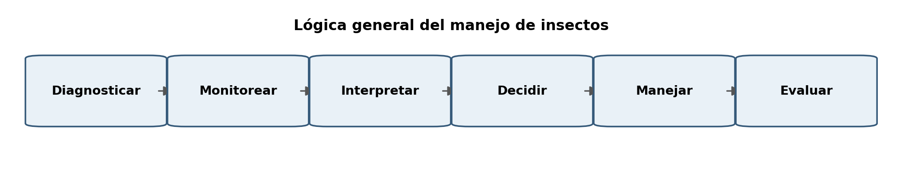
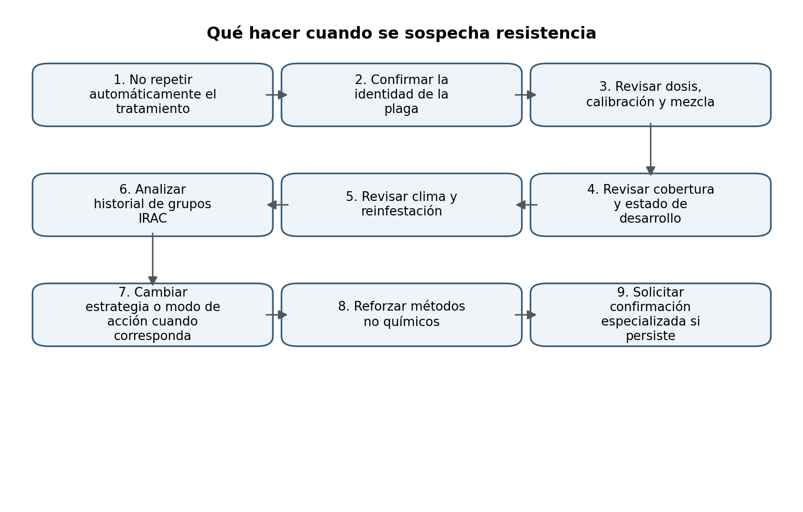
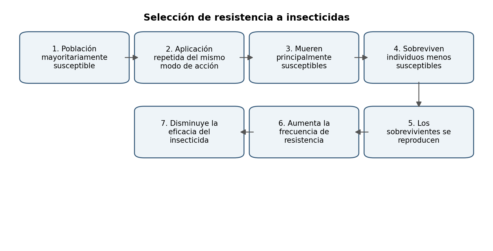
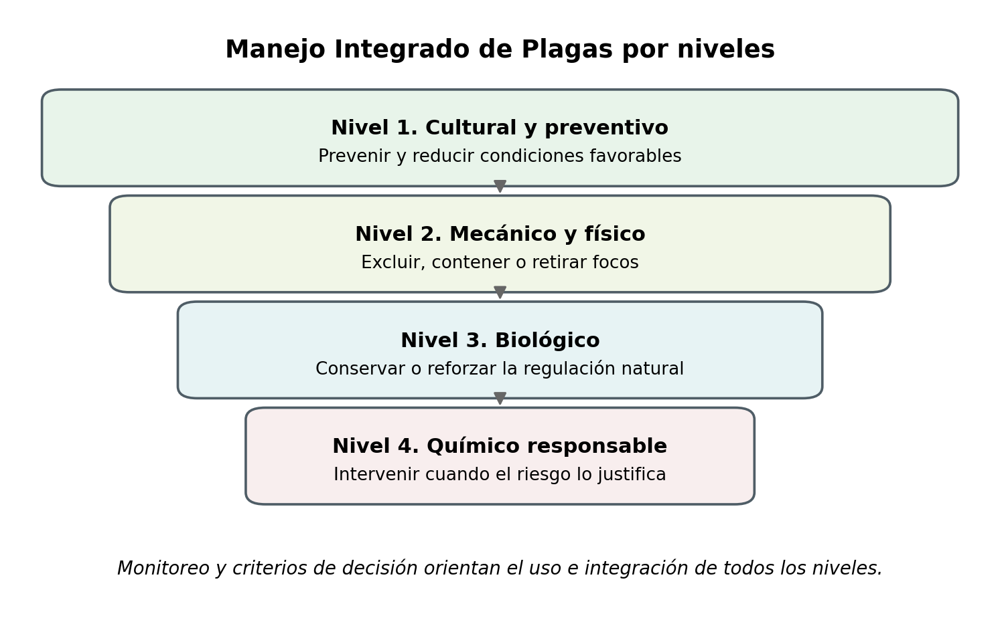
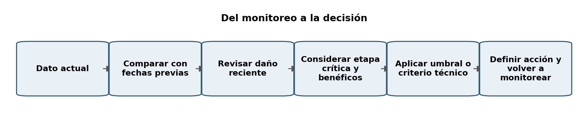
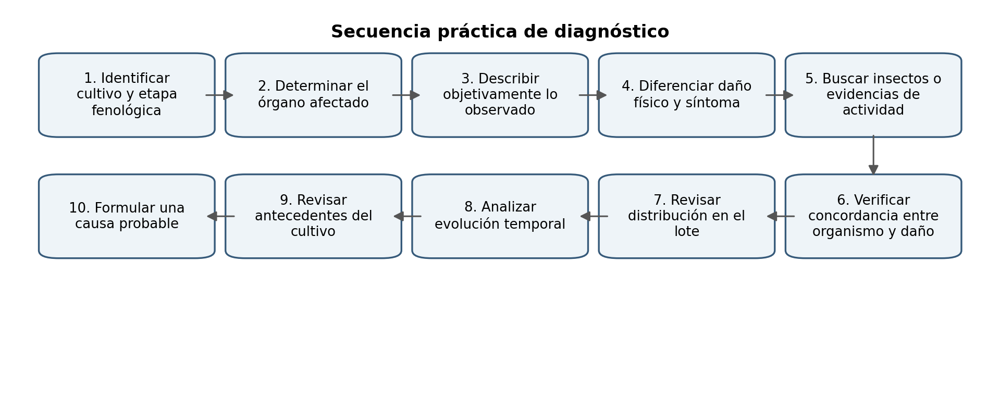

# Fuente — cap03

- **Docente:** <completar>
- **Ingerido:** 2026-11-11
- **Archivos:** monitoreo-control-insectos.docx

> Transcripcion fiel del material entregado. No editar para estilo: la redaccion didactica se hace en `02-libro.md`.
>
> Las imagenes se guardaron en `diseno/assets/cap03/` y aparecen abajo con su ruta ya lista para pegar en un bloque `:::figura`.

---

# Archivo: monitoreo-control-insectos.docx

3.1 Monitoreo y control de insectos en la agricultura

El manejo de insectos en agricultura debe entenderse como un proceso continuo y no como una acción aislada de control (Figura 1). Una decisión adecuada comienza por identificar correctamente el problema, continúa con el monitoreo sistemático y el registro de su evolución, y culmina en la selección de estrategias de manejo proporcionales al riesgo observado.

Dentro del Manejo Integrado de Plagas (MIP), el objetivo no consiste en eliminar todos los insectos presentes en el cultivo, sino en mantener las poblaciones potencialmente dañinas en niveles compatibles con la producción, procurando al mismo tiempo conservar los organismos benéficos, reducir aplicaciones innecesarias y disminuir los riesgos para las personas y el ambiente (Deguine et al., 2021).

Figura 1. Lógica general para el manejo de insectos en agricultura.

Cada etapa aporta información diferente. El diagnóstico permite establecer cuál puede ser la causa del problema; el monitoreo permite determinar dónde se encuentra y cómo evoluciona; el registro convierte las observaciones en información comparable; los criterios de decisión permiten establecer si es necesario intervenir; y el MIP orienta la selección de las estrategias más apropiadas. Cuando se requiere utilizar insecticidas, el manejo de resistencia adquiere especial importancia para conservar su eficacia a lo largo del tiempo.

3.1.1 Diagnóstico rápido del problema en campo: daño, síntoma y causa

3.1.1.1 Importancia del diagnóstico antes de tomar una decisión de control

El diagnóstico constituye uno de los primeros pasos para el manejo adecuado de los problemas fitosanitarios. Antes de seleccionar una medida de control es necesario determinar, con el mayor grado de certeza posible, qué está ocurriendo en la planta y cuál puede ser el agente o condición responsable.

La presencia de hojas amarillas, deformaciones, perforaciones, marchitez, necrosis o pérdida de tejido no implica necesariamente la existencia de una plaga de insectos. Los problemas observados pueden estar asociados con organismos vivos, factores ambientales, prácticas de manejo o con la interacción de varios de estos factores.

Un diagnóstico incorrecto puede conducir, por ejemplo, a aplicar un insecticida sobre plantas afectadas por una deficiencia nutricional, estrés hídrico, fitotoxicidad, daño mecánico o una enfermedad. Además de no resolver la causa original, una decisión de este tipo puede aumentar los costos de producción y afectar organismos benéficos. Por ello, el diagnóstico debe construirse a partir de varias evidencias y no de una sola observación (Munster, 2022; UC IPM, 2021).

3.1.1.2 Daño, síntoma, signo y causa

3.1.1.2.1 Daño

El daño corresponde a una alteración física o funcional de la planta o de alguno de sus órganos como consecuencia de la actividad de un agente dañino. En el caso de los insectos puede manifestarse como pérdida de tejido, perforaciones, raspado, galerías, minado, destrucción de brotes, daño de raíces o lesiones en flores, frutos y semillas. La forma del daño aporta información sobre el hábito alimenticio del organismo responsable (Edde, 2021; Fürstenberg-Hägg et al., 2013).

3.1.1.2.2 Síntoma

El síntoma es una respuesta observable de la planta ante una alteración o factor de estrés. Entre los síntomas frecuentes se encuentran clorosis o amarillamiento, marchitez, necrosis, reducción del crecimiento, deformaciones, enrollamiento de hojas, caída prematura de hojas, flores o frutos y muerte regresiva de tejidos. Un síntoma aislado generalmente no permite identificar la causa. Diferentes agentes infecciosos y no infecciosos pueden producir manifestaciones semejantes, lo que hace necesario considerar otras evidencias antes de establecer un diagnóstico (Bischoff et al., 2021).

3.1.1.2.3 Signo o evidencia directa

Para fines de esta guía, se entenderá por signo o evidencia directa cualquier elemento observable que permita relacionar el problema con la presencia o actividad de un organismo. En insectos y otros artrópodos pueden observarse adultos, larvas, ninfas, huevos, exuvias, excrementos, melaza, seda, galerías, perforaciones o restos de alimentación. Encontrar un insecto sobre una planta no demuestra por sí solo que sea responsable del daño, ya que puede tratarse de un organismo ocasional, un polinizador, un depredador o un parasitoide.

3.1.1.2.4 Causa

La causa corresponde al organismo, condición o combinación de condiciones responsables del problema observado. Puede ser biótica —insectos, ácaros, hongos, bacterias, virus o nematodos— o abiótica —déficit o exceso de agua, temperaturas extremas, deficiencias nutricionales, salinidad, fitotoxicidad, daño mecánico o problemas de suelo y drenaje—. Un mismo cultivo puede presentar simultáneamente más de un tipo de estrés, por lo que la diferenciación entre causas bióticas y abióticas debe interpretarse de manera flexible (UC IPM, 2021).

3.1.1.3 Principales tipos de daño ocasionados por insectos

Dentro de los principales tipos de daños que los insectos ocasionan en los cultivos podemos encontrar asociaciones con el tipo de aparato bucal que presenten, el hábito de visita y establecimiento en las plantas hospederas o incluso comportamientos estacionales dependientes del ciclo de vida del insecto (Cuadro 1).

Cuadro 1. Resumen no exhaustivo de los principales tipos de daños ocasionado por insectos en los cultivos.

Esta clasificación debe utilizarse como herramienta de orientación y no como identificación definitiva. Un mismo tipo de daño puede ser producido por diferentes especies y una misma especie puede generar daños distintos según su estado de desarrollo, densidad y órgano afectado.

3.1.1.4 Observar el órgano afectado

La observación es clave en la estrategia de manejo de los insectos plaga, para ello el conocimiento del comportamiento del insecto permite buscar en el lugar correcto. Algunas recomendaciones de observación por tipo de órganos son:

- Brotes y hojas jóvenes: buscar deformaciones, enrollamiento, pérdida de vigor y colonias de insectos.

- Haz y envés de las hojas: revisar áfidos, moscas blancas, trips, ácaros, huevos y ninfas. El envés requiere atención especial.

- Flores: buscar insectos pequeños dentro de estructuras florales, raspado, deformaciones y daño asociado con el cuajado.

- Frutos: revisar perforaciones, raspaduras, cicatrices, excrementos y orificios de entrada o salida.

- Tallos y ramas: buscar galerías, perforaciones, material expulsado y debilitamiento.

- Raíces y cuello: revisar cuando existe marchitez o pérdida de vigor sin una causa evidente en la parte aérea.

3.1.1.5 Patrón del problema y antecedentes del cultivo

Además de observar una planta individual, debe examinarse cómo se distribuye el problema en el lote. Conviene determinar si aparece en una sola planta, ocurre en focos, se concentra en bordes, sigue filas, se distribuye de manera uniforme o coincide con áreas húmedas, secas o con diferencias de suelo, riego o exposición. El patrón espacial constituye una evidencia diagnóstica importante, aunque no debe utilizarse de manera aislada (Munster, 2022).

También debe conocerse qué ocurrió antes de la aparición del problema. Resulta útil preguntar cuándo comenzaron los síntomas, si hubo lluvias intensas o periodos secos, si se aplicaron agroquímicos o fertilizantes, si cambió el sistema de riego, si se realizaron podas o labores mecánicas y si el cultivo se encuentra en una etapa particularmente sensible.

3.1.1.6 Secuencia práctica de diagnóstico

Cuando se integran los conocimientos del ciclo del cultivo dentro de la estrategia de manejo de las plagas se puede establecer una secuencia de acciones que mejoren las posibilidades del diagnóstico oportuno, ya que permite a los productores anticiparse a la plaga, su establecimiento y crecimiento. En la Figura 2 se propone una secuencia para mejorar el diagnóstico y tomar decisiones a tiempo.

Figura 2. Secuencia práctica para el diagnóstico rápido en campo.

Cuando la evidencia no es suficiente o existe riesgo de una plaga desconocida, regulada o cuarentenaria, debe solicitarse apoyo especializado y, cuando corresponda, realizar diagnóstico de laboratorio.

3.1.2 Monitoreo práctico: recorridos, revisión de plantas y trampas

3.1.2.1 Propósito del monitoreo

El monitoreo consiste en observar de manera sistemática la presencia, abundancia, distribución y evolución de organismos potencialmente dañinos y benéficos dentro del cultivo. No debe confundirse con una inspección ocasional. Su valor radica en utilizar un procedimiento suficientemente consistente para poder comparar observaciones entre fechas (Preti et al., 2021).

El monitoreo debe permitir determinar qué organismos están presentes, dónde se encuentran, en qué cantidad, qué estados de desarrollo predominan, qué daño existe y si aparecen organismos benéficos.

3.1.2.2 Monitoreo directo e indirecto

El monitoreo directo consiste en observar directamente las plantas mediante inspección de brotes, hojas, envés, flores, frutos, tallos y raíces cuando corresponda, además del conteo de estados de desarrollo y la observación de daño. El monitoreo indirecto utiliza dispositivos como trampas adhesivas, trampas con feromonas, trampas de luz u otros sistemas de captura. Estas herramientas permiten detectar actividad de determinados insectos, pero no sustituyen la inspección directa de las plantas (UC IPM, 2021; Preti et al., 2021).

3.1.2.3 Preparación y recorrido del cultivo

Antes de ingresar al lote conviene identificar el cultivo, la etapa fenológica, las plagas prioritarias, los antecedentes del lote, los sectores de riesgo y las condiciones climáticas recientes.

El recorrido debe atravesar diferentes sectores del cultivo. Pueden utilizarse patrones en W, zigzag, diagonales o recorridos sistemáticos equivalentes. Su propósito no es formar una figura geométrica exacta, sino evitar que la evaluación se limite a bordes, caminos o puntos de acceso fácil.

3.1.2.4 Muestreo representativo e inspección dirigida

El muestreo representativo busca observar plantas distribuidas en diferentes sectores del lote. La inspección dirigida se concentra adicionalmente en bordes, malezas hospederas, focos históricos, zonas húmedas o secas, entradas y áreas con síntomas. Ambos enfoques son complementarios.

La selección de plantas debe seguir un criterio constante y no limitarse a plantas visiblemente dañadas, ya que esto puede sobreestimar la incidencia. La cantidad de plantas depende del cultivo, la plaga, el tamaño del lote, el patrón de distribución y el protocolo utilizado; no existe una cantidad universal aplicable a todos los sistemas.

3.1.2.5 Qué revisar y qué estados buscar

Durante los monitoreos se pueden colectar datos de múltiples plagas al mismo tiempo, y es probable que el productor tenga más interés en algunas de las plagas más importantes; sin embargo, aprovechando el objetivo de visita rutinaria al cultivo, se pueden confeccionar pequeñas guías o tablas para buscar síntomas y signos asociados tanto por órgano como por tipo de daño, siempre cuantificando todo lo relevante para el desempeño del cultivo. Un ejemplo de tabla resumida de revisión, basada en el detalle que previamente se mencionó en la sección 3.1.1.4 y los estados de desarrollo más frecuentes de las plagas se presenta en el Cuadro 2 .

Cuadro 2. Ejemplo de tabla de revisión con aspectos resumidos de monitoreo.

Además de adultos, es importante buscar huevos, larvas, ninfas, pupas cuando sean visibles, exuvias e individuos parasitados. Encontrar diferentes estados puede ayudar a determinar si la población está establecida y reproduciéndose.

3.1.2.6 Frecuencia de monitoreo

La frecuencia depende de la plaga, el cultivo, la etapa fenológica, el clima, los antecedentes y el nivel de riesgo. Durante etapas críticas puede ser necesario aumentar la frecuencia para detectar cambios antes de que el daño alcance niveles difíciles de manejar.

3.1.2.7 Uso de trampas cromáticas adhesivas

Las trampas adhesivas se utilizan principalmente para detectar y seguir la actividad de insectos adultos voladores. Pueden ayudar a detectar llegada, localizar zonas con mayor actividad y reconocer cambios relativos entre fechas (Böckmann et al., 2021; UC IPM, 2021). Las trampas combinan atracción para la plaga con múltiples elementos, por ejemplo colores como amarillo, azul, rojo, blanco, verdes, e incluso negras, siento las amarillas y azul las más utilizadas por su amplio espectro. También en los adhesivos algunas trampas incorporan feromonas y moléculas de agregación y comunicación (semioquímicos), así como elementos luminosos para atracción nocturna. Un resumen de la acción de las dos principales trampas cromáticas adhesivas del mercado se presenta en el Cuadro 3.

Cuadro 3. Resumen del uso, atracción, ventajas y desventajas de las trampas cromáticas más frecuentes en el mercado.

3.1.2.8 Instalación, mantenimiento y lectura

Para poder comparar resultados deben mantenerse constantes las condiciones de monitoreo, en lo posible, el color, tamaño, ubicación, altura, tiempo de exposición, frecuencia de cambio e identificación de cada trampa. La altura debe ajustarse conforme crece el cultivo y según el comportamiento del insecto objetivo.

La lectura debe registrar el código de la trampa, ubicación, fecha de instalación, fecha de lectura, grupos objetivo y número de capturas. Las capturas deben interpretarse principalmente como una medida relativa de actividad y no como una orden automática de control. Sin embargo, hay que tomar en cuenta que: Una trampa detecta actividad; la inspección de la planta permite confirmar qué está ocurriendo en el cultivo.

3.1.3 Registro simple para decisiones

3.1.3.1 Por qué registrar

El registro convierte las observaciones del monitoreo en información comparable. Debe permitir conocer cuánto había, dónde, cuándo, cómo cambió la población, qué daño ocurrió, qué organismos benéficos estaban presentes, qué acción se tomó y qué ocurrió después. El Cuadro 4 sugiere a continuación una forma de ordenar la información del monitoreo para la sistematización de las decisiones.

Cuadro 4. Alternativa de registro para el monitoreo de las plagas.

3.1.3.2 Mantener unidades comparables

Ejemplos de unidades útiles son insectos por hoja, larvas por planta, adultos por trampa por siete días o porcentaje de plantas afectadas. Cambiar la unidad entre fechas impide interpretar correctamente la serie. También debe conservarse, en la medida de lo posible, el método de observación, el tiempo de exposición de las trampas y el número de unidades revisadas.

3.1.3.3 Tendencias y daño reciente

Un dato aislado tiene menor valor que una secuencia. Una serie 10 → 11 → 10 → 12 sugiere estabilidad relativa, mientras que 2 → 4 → 7 → 12 indica una tendencia creciente, aunque ambas terminen en el mismo valor. La pregunta principal debe ser si la población aumenta, disminuye o permanece estable.

También debe distinguirse entre daño reciente, que evidencia actividad actual, y daño acumulado, que puede permanecer visible, aunque la población haya disminuido. Esta distinción es esencial para evaluar la necesidad de intervenir y la eficacia de acciones previas.

3.1.3.4 Etapa fenológica, clima y organismos benéficos

La importancia de una plaga depende de cuándo aparece. Debe registrarse la etapa del cultivo —establecimiento, crecimiento vegetativo, floración, cuajado, desarrollo de fruto, maduración o cosecha— y reconocer las etapas críticas en las que un daño relativamente pequeño puede tener consecuencias relevantes.

El clima puede registrarse de forma sencilla, por ejemplo, estación lluviosa, seca, clima cálido, frío, viento fuerte o humedad elevada. Esta información aporta contexto para interpretar cambios poblacionales, pero no sustituye el monitoreo.

Los organismos benéficos deben registrarse como una variable adicional de decisión. Pueden utilizarse categorías como ausentes, escasos, moderados o abundantes. Su presencia y tendencia pueden modificar la interpretación de una población de plaga y la conveniencia de intervenir (Lundin et al., 2021).

3.1.3.5 Umbral de acción y nivel de daño económico

El nivel de daño económico representa, en términos generales, la densidad de plaga en la cual el valor de las pérdidas ocasionadas equivale aproximadamente al costo del control. El umbral de acción es el nivel en el cual debe iniciarse una acción para evitar que la población alcance el nivel de daño económico (Hoidal & Koch, 2021).

Los umbrales no son universales. Pueden depender de la especie de plaga, cultivo, variedad, etapa fenológica, ambiente, valor del producto, costo de control y tolerancia del mercado al daño. Cuando no existe un umbral validado, no debe inventarse un número; puede utilizarse un criterio práctico de campo basado en tendencia, daño reciente, proporción de plantas afectadas, etapa crítica, presencia de benéficos y antecedentes.

3.1.3.6 Matriz orientativa de decision

Tomando de base la observación, la experiencia de los productores, la teoría sobre el comportamiento de algunas plagas y el sentido común en el manejo agronómico, se presenta en el Cuadro 5 y la Figura 3, una clave resumida de interpretación que puede adaptarse a las condiciones especiales de cada cultivo y finca.

Cuadro 5. Interpetación y algunas decisiones frecuentes derivadas del monitoreo de las plagas.

Figura 3. Secuencia para convertir el monitoreo en una decisión de manejo.

3.1.3.7 Registrar y evaluar la acción

Cuando se toma una medida de manejo debe registrarse la fecha, método, sector tratado, producto o estrategia, dosis cuando corresponda y observaciones. Después de intervenir debe realizarse un nuevo monitoreo para verificar si disminuyó la población, disminuyó el daño reciente, dejaron de aparecer focos o se protegió la etapa crítica.

3.1.4 Manejo Integrado de Plagas por niveles

3.1.4.1 Concepto y lógica de integración

El Manejo Integrado de Plagas (MIP) integra diferentes estrategias de prevención y manejo seleccionadas según el diagnóstico, el monitoreo y el riesgo. No significa eliminar todos los insectos, utilizar varios productos o aplicar diferentes insecticidas de manera rutinaria. Su objetivo es mantener las poblaciones potencialmente dañinas en niveles compatibles con la producción mediante la combinación de herramientas más apropiada (Deguine et al., 2021). La Figura 4 detalla el principio del MIP según niveles de intervención respecto de las medidas implementadas y su objetivo práctico.

Figura 4. Organización práctica del Manejo Integrado de Plagas por niveles.

3.1.4.2 Nivel 1. Manejo cultural y preventivo

El manejo cultural y preventivo busca reducir las condiciones que favorecen la llegada, establecimiento, reproducción o supervivencia de la plaga. Puede incluir el uso de material sano, saneamiento, eliminación de focos, manejo de residuos infestados, rotación de cultivos cuando sea biológicamente apropiada, ajuste de fechas de siembra, nutrición equilibrada, manejo adecuado del riego y densidad del cultivo.

La regulación ecológica también forma parte de la prevención. La conservación de hábitats funcionales, bordes florales, refugios y fuentes de néctar o polen puede ayudar a mantener depredadores y parasitoides. Estas prácticas deben diseñarse cuidadosamente para evitar favorecer también a la plaga (Tooker et al., 2020; Zhu et al., 2022).

3.1.4.3 Nivel 2. Manejo mecánico y físico

Los métodos mecánicos y físicos buscan excluir, contener o retirar directamente a la plaga. Entre los métodos mecánicos pueden encontrarse la recolección manual, eliminación de masas de huevos, poda de brotes infestados, retiro de frutos dañados, aspiración o destrucción de focos. Entre los métodos físicos pueden utilizarse mallas, barreras, embolsado, exclusión, trampas y tratamientos físicos específicos.

Cuando la infestación está concentrada puede ser preferible actuar sobre el foco antes de tratar todo el lote, siempre que la biología y movilidad de la plaga lo permitan. Esta práctica puede reducir costos y disminuir la exposición de organismos benéficos.

3.1.4.4 Nivel 3. Control biológico

3.1.4.4.1 Control biológico natural

Ocurre cuando enemigos naturales presentes en el agroecosistema regulan espontáneamente las poblaciones de plagas.

3.1.4.4.2 Control biológico por conservación

Busca proteger y favorecer a los enemigos naturales mediante menor perturbación, reducción de aplicaciones innecesarias de amplio espectro, mantenimiento de refugios y provisión de recursos adecuados. Tooker et al. (2020) señalan que reducir perturbaciones puede fortalecer las comunidades de enemigos naturales y su contribución al control de plagas.

3.1.4.4.3 Control biológico aumentativo

Incluye liberaciones deliberadas de parasitoides, depredadores o microorganismos entomopatógenos. Su eficacia depende de la identificación correcta de la plaga, selección del agente, estado de desarrollo, momento de liberación, temperatura, humedad y compatibilidad con otras medidas.

3.1.4.4.4 Precauciones con productos biológicos

El término biológico no debe interpretarse automáticamente como inocuo para todos los organismos no objetivo. Cappa et al. (2022) documentan que algunos bioplaguicidas pueden producir efectos adversos, incluso subletales, sobre polinizadores. Por ello, toda herramienta debe evaluarse según su eficacia, selectividad y riesgo.

3.1.4.5 Nivel 4. Control químico responsable

El control químico puede formar parte del MIP cuando el monitoreo y el nivel de riesgo justifican su utilización. Antes de aplicar deben verificarse cuatro condiciones básicas: necesidad justificada, producto apropiado, momento y cobertura adecuados, y protección de organismos no objetivo.

- Necesidad justificada: el monitoreo y el criterio de decisión indican que es necesario intervenir.

- Producto apropiado: el producto está autorizado y es eficaz contra la plaga objetivo.

- Momento y cobertura adecuados: la aplicación se dirige al estado susceptible y alcanza el sitio donde se encuentra la plaga.

- Protección de organismos no objetivo: se procura minimizar el impacto sobre enemigos naturales y polinizadores.

La rotación detallada por modo de acción y otras prácticas relacionadas con resistencia se desarrollan en la sección 3.1.5.

3.1.4.6 Protección de enemigos naturales y polinizadores

Siempre que existan alternativas eficaces debe procurarse utilizar productos más selectivos, evitar aplicaciones innecesarias y tratar focos cuando sea técnicamente posible. La conservación de enemigos naturales puede reducir la dependencia del control químico.

Antes de aplicar debe revisarse la floración, actividad de abejas y otros polinizadores, presencia de malezas florecidas, condiciones de viento, restricciones de etiqueta y riesgo de deriva. El manejo de plagas y la conservación de polinizadores deben considerarse de forma integrada (Lundin et al., 2021).

3.1.5 Resistencia a insecticidas: señales, prevención y manejo

3.1.5.1 Qué es la resistencia

La resistencia es una reducción heredable de la susceptibilidad de una población a un insecticida que anteriormente proporcionaba un nivel adecuado de control cuando era utilizado correctamente. El cambio ocurre en la población del insecto, no en el producto.

3.1.5.2 Selección de Resistencia

Las prácticas agrícolas de uso intensivo de insecticidas a dosis subletales y la exposición repetida del mismo ingrediente activo (a pesar de que se apliquen productos con nombres diferentes), son las principales razones del surgimiento de plagas resistentes. La biología del insecto le faculta para en periodos cortos adoptar estrategias de sobrevivencia y adaptación al entorno, donde pocos individuos pueden regenerar poblaciones numerosas de insectos (reproducción sexual o asexual (vivíparos)) capaces de completar su ciclo de vida aún en presencia de insecticidas recurrentes, que a base de mutaciones establecen mecanismos bioquímicos para tolerar bajas dosis del químico. La Figura 5 presenta un diagrama abreviado de cómo la sobre aplicación de moléculas químicas presiona la adaptación del insecto plaga.

Figura 5. Proceso simplificado de selección de resistencia a insecticidas.

El proceso puede acelerarse cuando se realizan aplicaciones frecuentes, se utiliza repetidamente el mismo modo de acción, se trata por calendario o se depende excesivamente del control químico. El manejo de resistencia busca reducir esta presión de selección y preservar la eficacia de las herramientas disponibles (Sparks et al., 2021).

3.1.5.3 Resistencia no es igual a falla de control

Antes de sospechar resistencia deben descartarse otras causas como mala cobertura, dosis incorrecta, producto equivocado, mala calibración, lluvia posterior, aplicación tardía, predominio de estados poco susceptibles o reinfestación. Una falla de control es una señal para investigar, no una prueba automática de resistencia. En el Cuadro 6 se resumen algunas situaciones que pueden confundirse con resistencia.

Cuadro 6. Resumen de situaciones que favorecen la falla de control del insecticida sin llegar a resistencia de la plaga.

3.1.5.4 Señales y confirmación

Las señales de sospecha incluyen pérdida progresiva de eficacia, sobrevivencia recurrente en áreas correctamente tratadas, necesidad creciente de repetir aplicaciones e historial intenso del mismo grupo IRAC (Insecticide Resistance Action Committee, según el acrónimo en inglés). La confirmación puede requerir bioensayos, pruebas bioquímicas o pruebas moleculares realizadas en laboratorios especializados.

3.1.5.5 Principales mecanismos

La mayoría de los mecanismos asociados con la inducción de resistencia en insectos plagas agrícolas recae en la capacidad de adaptación del insecto. Algunos de ellos son:

- Modificación del sitio de acción: el blanco sobre el cual actúa el insecticida cambia y el producto pierde eficacia.

- Resistencia metabólica: aumenta la capacidad del insecto para degradar o detoxificar el producto. Los citocromos P450 tienen un papel particularmente relevante (Nauen et al., 2022).

- Menor penetración: cambios estructurales reducen la velocidad de ingreso del producto.

- Cambios de comportamiento: el insecto evita superficies tratadas o reduce su exposición.

Una población puede presentar varios mecanismos simultáneamente. La resistencia cruzada ocurre cuando un mismo mecanismo reduce la susceptibilidad a varios insecticidas; la resistencia múltiple ocurre cuando una población acumula mecanismos frente a diferentes grupos.

3.1.5.6 Presión de selección y aplicaciones por calendario

La presión de selección aumenta cuando se realizan numerosas aplicaciones, se utiliza repetidamente el mismo modo de acción, varias generaciones quedan expuestas al mismo mecanismo y existe una alta dependencia del control químico. Cada aplicación innecesaria representa una oportunidad adicional de seleccionar individuos resistentes. Por ello, monitoreo, umbrales y MIP contribuyen directamente a reducir la presión de selección.

3.1.5.7 Rotación por modo de acción

IRAC clasifica los insecticidas según su modo de acción. Cambiar de marca comercial no significa necesariamente cambiar de modo de acción. Dos o más productos con ingredientes activos distintos pueden pertenecer al mismo grupo y ejercer una presión de selección semejante. La clasificación IRAC constituye una herramienta fundamental para diseñar programas de manejo de resistencia (Sparks et al., 2020).

Una rotación conceptual adecuada alterna grupos de modo de acción diferentes —por ejemplo Grupo 1→ Grupo 2 → Grupo 3 … etc — siempre que los productos estén autorizados, sean eficaces para la plaga y se utilicen conforme a la etiqueta. Cuando sea posible, debe evitarse exponer varias generaciones sucesivas al mismo grupo. En determinados programas se utilizan ventanas o bloques de modo de acción cuyo diseño depende del ciclo de la plaga, persistencia del producto y recomendaciones específicas.

3.1.5.8 Dosis, momento y cobertura desde la perspectiva de resistencia

La dosis debe corresponder a la autorizada en la etiqueta; no debe subdosificarse deliberadamente ni aumentarse arbitrariamente. El momento debe priorizar estados susceptibles y la cobertura debe alcanzar el sitio donde se encuentra la plaga. Una mala cobertura puede generar sobrevivientes y simular resistencia.

3.1.5.9 Mezclas

Una mezcla de insecticidas no garantiza automáticamente un mejor manejo de resistencia. Debe evaluarse su autorización, eficacia, compatibilidad, modos de acción, riesgos y función dentro de la estrategia global. IRAC (2023) indica que las mezclas deben incorporarse cuidadosamente en programas de manejo de resistencia y no utilizarse simplemente como una forma de aumentar la intensidad del tratamiento.

3.1.5.10 Historial de aplicaciones

Mantener actualizado el historial de las aplicaciones permite identificar repeticiones inadvertidas del mismo grupo aunque se hayan utilizado marcas o ingredientes activos diferentes. El Cuadro 7 presenta una propuesta de registro orientado a identificar la repetición innecesaria y riesgosa de ingredientes activos relacionados desde la perspectiva de inducción de resistencia y el resultado de la aplicación como evidencia.

Cuadro 7. Registro abreviado para la identificación rápida de la repetición riesgosa de ingredientes activos.

3.1.5.11 Qué hacer cuando se sospecha resistencia

Es muy probable que cuando se incorporan aplicaciones de insecticidas con manejo por calendario se observen luego en algún momento indicios o evidencia contundente de la resistencia de plagas en los cultivos. Normalmente la acción de parte del productor es aumentar la dosis de forma arbitraria o mezclar productos que en pasado le dieron buenos resultados. Esto es una forma rápida de agravar la situación y por el contrario se debe actuar de forma dirigida para evitar que la plaga resistente se reproduzca a niveles fuera de manejo. Parte de las acciones de mitigación es el uso de otros tipos de control bajo el enfoque de MIP y por supuesto variar la estrategia de aplicaciones de insecticidas (Figura 6).

Figura 6. Secuencia recomendada ante una sospecha de resistencia.

3.1.5.12 Principio general de prevención

El manejo de resistencia no consiste únicamente en cambiar insecticidas. Consiste en reducir la dependencia del control químico, disminuir las exposiciones innecesarias y evitar que generaciones sucesivas de una plaga enfrenten repetidamente el mismo modo de acción. En términos prácticos: menos aplicaciones innecesarias + mejor momento + mejor cobertura + dosis correcta + rotación real + MIP = menor presión de selección.

3.1.6 Integración operativa del capítulo

El manejo de insectos puede resumirse como una secuencia única: identificar correctamente el problema; monitorear de manera representativa; registrar de forma consistente; analizar tendencia, daño, etapa y benéficos; decidir con base en umbral o criterio técnico; priorizar prevención y métodos compatibles con MIP; utilizar control químico solo cuando esté justificado; manejar los modos de acción para reducir resistencia; y volver a monitorear para evaluar el resultado. Esta lógica evita que el manejo se reduzca a una respuesta reactiva basada en aplicaciones y permite construir decisiones técnicamente sustentadas, adaptables a diferentes cultivos y condiciones productivas.

Referencias

Bischoff, V., Farias, K., Menzen, J. P., & Pessin, G. (2021). Technological support for detection and prediction of plant diseases: A systematic mapping study. Computers and Electronics in Agriculture, 181, 105922. https://doi.org/10.1016/j.compag.2020.105922

Böckmann, E., Pfaff, A., Schirrmann, M., & Pflanz, M. (2021). Rapid and low-cost insect detection for analysing species trapped on yellow sticky traps. Scientific Reports, 11, 10419. https://doi.org/10.1038/s41598-021-89930-w

Cappa, F., Baracchi, D., & Cervo, R. (2022). Biopesticides and insect pollinators: Detrimental effects, outdated guidelines, and future directions. Science of the Total Environment, 837, 155714. https://doi.org/10.1016/j.scitotenv.2022.155714

Deguine, J.-P., Aubertot, J.-N., Flor, R. J., Lescourret, F., Wyckhuys, K. A. G., & Ratnadass, A. (2021). Integrated pest management: Good intentions, hard realities. A review. Agronomy for Sustainable Development, 41, 38. https://doi.org/10.1007/s13593-021-00689-w

Edde, P. A. (2021). Field crop arthropod pests of economic importance. Academic Press. https://www.sciencedirect.com/book/monograph/9780128186213/field-crop-arthropod-pests-of-economic-importance

Fürstenberg-Hägg, J., Zagrobelny, M., & Bak, S. (2013). Plant defense against insect herbivores. International Journal of Molecular Sciences, 14(5), 10242–10297. https://doi.org/10.3390/ijms140510242

Hoidal, N., & Koch, R. L. (2021). Perception and use of economic thresholds among farmers and agricultural professionals: A case study on soybean aphid in Minnesota. Journal of Integrated Pest Management, 12(1), 9. https://doi.org/10.1093/jipm/pmab003

Insecticide Resistance Action Committee. (2023). Insecticide mixtures and resistance management: Updated guidance. IRAC. https://irac-online.org/insecticide-mixtures-and-resistance-management-updated-guidance/

Lundin, O., Rundlöf, M., Jonsson, M., Bommarco, R., & Williams, N. M. (2021). Integrated pest and pollinator management—Expanding the concept. Frontiers in Ecology and the Environment, 19(5), 283–291. https://doi.org/10.1002/fee.2325

Munster, M. (2022). Diagnostics. In K. A. Moore & L. K. Bradley (Eds.), North Carolina extension gardener handbook (2nd ed., Chapter 7). NC State Extension. https://content.ces.ncsu.edu/extension-gardener-handbook/7-diagnostics

Nauen, R., Bass, C., Feyereisen, R., & Vontas, J. (2022). The role of cytochrome P450s in insect toxicology and resistance. Annual Review of Entomology, 67, 105–124. https://doi.org/10.1146/annurev-ento-070621-061328

Preti, M., Verheggen, F., & Angeli, S. (2021). Insect pest monitoring with camera-equipped traps: Strengths and limitations. Journal of Pest Science, 94, 203–217. https://doi.org/10.1007/s10340-020-01309-4

Sparks, T. C., Crossthwaite, A. J., Nauen, R., Banba, S., Cordova, D., Earley, F., Ebbinghaus-Kintscher, U., Fujioka, S., Hirao, A., Karmon, D., Kennedy, R., Nakao, T., Popham, H. J. R., Salgado, V., Watson, G. B., Wedel, B. J., & Wessels, F. J. (2020). Insecticides, biologics and nematicides: Updates to IRAC's mode of action classification—A tool for resistance management. Pesticide Biochemistry and Physiology, 167, 104587. https://doi.org/10.1016/j.pestbp.2020.104587

Sparks, T. C., Storer, N., Porter, A., Slater, R., & Nauen, R. (2021). Insecticide resistance management and industry: The origins and evolution of the Insecticide Resistance Action Committee (IRAC) and the mode of action classification scheme. Pest Management Science, 77(6), 2609–2619. https://doi.org/10.1002/ps.6254

Tooker, J. F., O'Neal, M. E., & Rodriguez-Saona, C. (2020). Balancing disturbance and conservation in agroecosystems to improve biological control. Annual Review of Entomology, 65, 81–100. https://doi.org/10.1146/annurev-ento-011019-025143

UC Statewide Integrated Pest Management Program. (2021). Diagnosing plant problems. In UC IPM pest management guidelines: Floriculture and ornamental nurseries (UC ANR Publication 3392). University of California Agriculture and Natural Resources. https://ipm.ucanr.edu/agriculture/floriculture-and-ornamental-nurseries/diagnosing-plant-problems/

UC Statewide Integrated Pest Management Program. (2021). Monitoring with sticky traps. In UC IPM pest management guidelines: Floriculture and ornamental nurseries (UC ANR Publication 3392). University of California Agriculture and Natural Resources. https://ipm.ucanr.edu/agriculture/floriculture-and-ornamental-nurseries/monitoring-with-sticky-traps/

Zhu, P., Zheng, X., Johnson, A. C., Chen, G., Xu, H., Yao, X., Heong, K. L., Zhang, F., Lu, Z., & Gurr, G. M. (2022). Ecological engineering for rice pest suppression in China. A review. Agronomy for Sustainable Development, 42, 69. https://doi.org/10.1007/s13593-022-00800-9

Tipo de daño | Manifestaciones frecuentes | Grupos frecuentemente asociados

Masticación | Bordes consumidos, agujeros y pérdida de tejido. | Larvas de lepidópteros, coleópteros y algunos ortópteros.

Succión | Clorosis, debilitamiento, deformación, enrollamiento y, en ciertos casos, melaza. | Áfidos, moscas blancas, chinches, cicadélidos y otros hemípteros.

Raspado y succión | Áreas plateadas o bronceadas, cicatrices y deformaciones. | Trips.

Minado | Galerías o áreas translúcidas dentro de las hojas. | Moscas minadoras y algunas larvas de lepidópteros o coleópteros.

Barrenado | Orificios y galerías en tallos, ramas, frutos o semillas. | Diversos coleópteros y lepidópteros.

Daño de raíces | Raíces consumidas o perforadas, pérdida de vigor y marchitez. | Insectos asociados al suelo.

Estructura | Aspectos principales de revisión

Brotes | Deformaciones: producidas por el establecimiento de colonias, puestas de huevos y estados inmaduros en alimentación.

Hojas | Haz y envés con daño mecánico: por la puesta de huevos en la epidermis, la alimentación de ninfas, larvas y adultos.

Flores | Pétalos y sépalos con daño mecánico y deformación: por alimentación y establecimiento de Trips en todas sus etapas.

Frutos | Perforaciones: debido a la alimentación y refugio de larvas que además generan cicatrices y depositan excrementos.

Tallos | Galerías y perforaciones: producto de la alimentación y refugio de larvas que se alimentan de la savia que se transporta en el tallo.

Raíces | Daño mecánico: Revisar cuando existen síntomas sin explicación visible en la parte aérea, relacionadas con alimentación de larvas que tienen periodos de incubación en el suelo.

Característica | Trampa amarilla | Trampa azul

Uso principal | Monitoreo general de insectos voladores. | Monitoreo más dirigido, especialmente de trips.

Grupos frecuentes | Moscas blancas, trips, áfidos alados, psílidos, cicadélidos, minadores y otros. | Principalmente trips.

Ventaja | Amplio espectro de capturas. | Mayor atractivo para determinados trips.

Limitación | Puede capturar organismos no objetivo. | Puede dificultar la visualización y conteo de algunos insectos.

Fecha | Lote | Etapa | Plaga | Unidad | Conteo | Daño | Benéficos | Clima | Acción

15/06 | A2 | Floración | Trips | adultos/trampa/7 días | 18 | Leve, reciente | Moderados | Seco | Aumentar monitoreo

Situación observada | Interpretación inicial | Respuesta

Población baja y estable + poco daño + benéficos presentes | Riesgo actual bajo. | Continuar monitoreo.

Población baja pero creciente | Alerta temprana. | Aumentar frecuencia de revisión.

Población creciente + daño reciente | Riesgo en aumento. | Revisar umbral o criterio de acción.

Población creciente + daño creciente + etapa crítica | Riesgo elevado. | Considerar una medida MIP.

Capturas altas en trampas sin daño confirmado | Actividad de adultos sin confirmación de infestación. | Intensificar inspección directa.

Población alta pero disminuyendo + benéficos abundantes | Posible regulación biológica. | Confirmar tendencia antes de intervenir.

Situación | ¿Puede parecer resistencia? | Qué revisar

Mala cobertura | Sí | Equipo, volumen, penetración y ubicación de la plaga.

Dosis incorrecta | Sí | Etiqueta, calibración y preparación de la mezcla.

Aplicación tardía | Sí | Estado de desarrollo de la plaga.

Lluvia posterior | Sí | Intervalo entre aplicación y precipitación.

Producto no apropiado | Sí | Registro, etiqueta y plaga objetivo.

Supervivencia repetida en áreas correctamente tratadas | Sí, mayor sospecha | Historial de uso y grupos de modo de acción.

Pérdida progresiva de eficacia | Sí, mayor sospecha | Programa de aplicaciones y confirmación técnica.

Fecha | Plaga | Producto | Ingrediente activo | Grupo IRAC | Dosis | Resultado

01/05 | Mosca blanca | Producto A | Activo X | 4A | Según etiqueta | Control bueno

12/05 | Mosca blanca | Producto B | Activo Y | 4A | Según etiqueta | Control moderado

24/05 | Mosca blanca | Producto C | Activo Z | 4A | Según etiqueta | Control bajo

### Imagenes del documento

<!-- FUENTE: un .docx no conserva la posicion de las imagenes en el texto; ubicarlas al redactar 02-libro.md. -->

