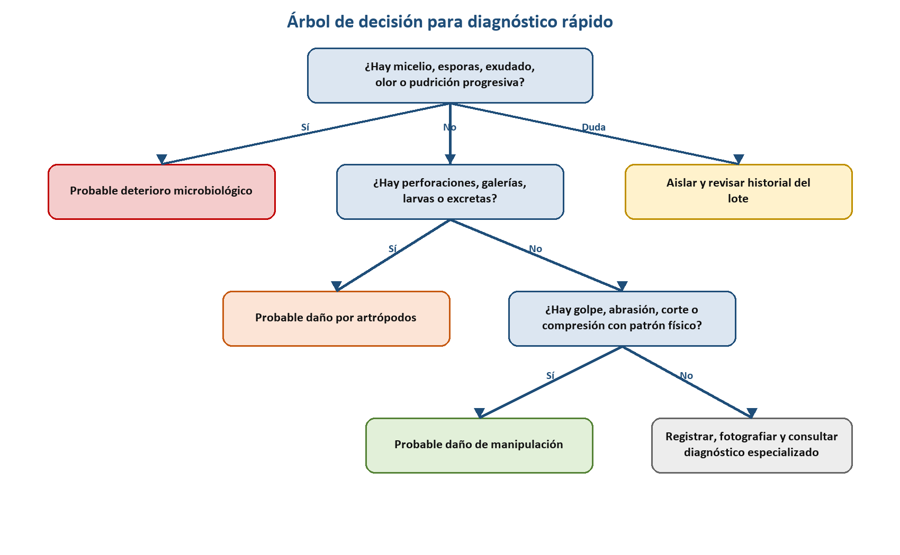
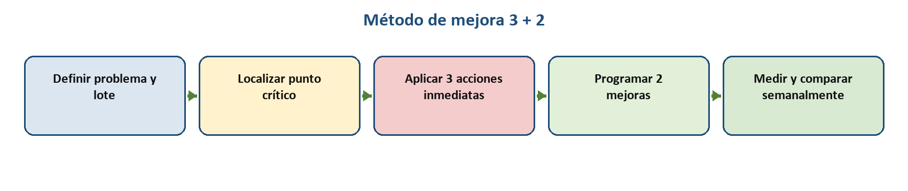
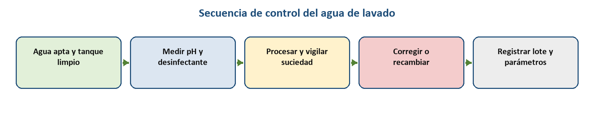
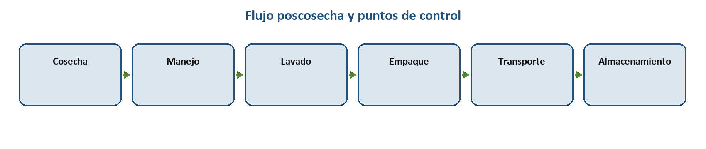

# Fuente — cap05

- **Docente:** <completar>
- **Ingerido:** 2026-11-11
- **Archivos:** tratamientos-poscosecha.docx

> Transcripcion fiel del material entregado. No editar para estilo: la redaccion didactica se hace en `02-libro.md`.
>
> Las imagenes se guardaron en `diseno/assets/cap05/` y aparecen abajo con su ruta ya lista para pegar en un bloque `:::figura`.

---

# Archivo: tratamientos-poscosecha.docx

3.2 TRATAMIENTOS
POSCOSECHA

Guía técnica para capacitación de productores y personal de manejo hortifrutícola

Diagnóstico · prevención · manejo del agua · conservación · mejora continua

Versión técnica | Agosto de 2026

## 3.2 Tratamientos poscosecha

La calidad de una fruta u hortaliza no mejora después de la cosecha: el propósito del manejo poscosecha es conservar la calidad producida en campo, disminuir daños físicos y fisiológicos, limitar el deterioro microbiológico y proteger la inocuidad durante el recorrido hasta el mercado. Por ello, esta guía trata la poscosecha como un sistema continuo y no como una colección de tratamientos aislados (Kader, 2002; Yahia, 2019).

El manejo poscosecha incluye reconocer causas probables de deterioro, ubicar el punto del proceso donde se originó el problema, seleccionar medidas proporcionales al riesgo y a la inversión disponible, y comprobar el resultado mediante indicadores sencillos por lote (Kitinoja & Kader, 2015; FAO, 1989).

## 3.2.1 Diagnóstico rápido poscosecha: afectación por microorganismos, artrópodos y manipulación

### 3.2.1.1 Reconocimiento de causas probables

El deterioro microbiológico suele progresar en el tiempo y puede expresarse como pudrición blanda, acuosa o seca, lesiones hundidas, micelio, esporulación, exudados u olores anormales. Hongos como Botrytis, Penicillium, Rhizopus, Alternaria y Colletotrichum son frecuentes en diferentes productos, mientras que bacterias pectinolíticas se asocian con pudriciones blandas; la identificación definitiva requiere considerar cultivo, condiciones y, cuando sea necesario, confirmación especializada (Barkai-Golan, 2001; Kader, 2002).

El daño por artrópodos puede observarse como perforaciones, galerías, raspaduras, cicatrices, larvas, adultos, mudas o excretas. Además de reducir la apariencia comercial, estas lesiones pueden abrir vías de entrada para microorganismos, de modo que una fruta puede presentar simultáneamente daño primario por insecto y pudrición secundaria (Kader, 2002; Kitinoja & Kader, 2015).

El daño de manipulación incluye impactos, magulladuras, cortes, abrasiones, punciones, compresión y aplastamiento. Parte del daño es interno o latente: una pieza puede parecer sana al empacarse y desarrollar oscurecimiento, ablandamiento o pudrición días después; la madurez, el tiempo desde cosecha, la temperatura y la fuerza aplicada modifican su susceptibilidad (Hussein et al., 2020; Opara & Pathare, 2014). El Cuadro 1 y la Figura 1 presentan un resumen de diagnóstico rápido y un árbol de decisión por observación y causa.

Cuadro 1. Matriz de diagnóstico rápido poscosecha

Nota. Diagnóstico preliminar basado en patrones; la ausencia de signos visibles no descarta daño interno. Fuente: elaboración propia con base en Barkai-Golan (2001), Kader (2002), Hussein et al. (2020) y Opara y Pathare (2014).

Figura 1. Árbol de decisión para el diagnóstico rápido poscosecha.

El árbol orienta una primera clasificación, pero el operador debe registrar fecha, parcela o proveedor, hora de cosecha, variedad, fotografías, proporción afectada, condiciones de agua y temperatura, y momento en que apareció el síntoma. Esa trazabilidad permite distinguir un evento aislado de un patrón repetitivo y facilita la consulta técnica. (Yahia, 2019; FDA, 1998)

## 3.2.2 Puntos críticos del proceso: cosecha → manejo → lavado → empaque → transporte → almacenamiento

Existen múltiples puntos de control poscosecha que ameritan acciones específicas para procurar mantener la calidad de los productos de la mejor forma. Estos puntos presentan manipulación variable y se debe reducir el riesgo de daño al mínimo mediante la implementación de buenas prácticas poscosecha. El flujo va desde el momento en que se retira el fruto o el vegetal de la planta, hasta que se almacena para su comercialización o proceso (Figura 2).

Figura 2. Flujo poscosecha y puntos de control.

Los riesgos prioritarios de cada etapa y algunas medidas de control básico recomendado se resumen en el Cuadro 2.

Cuadro 2. Puntos críticos, señales y controles.

Nota. HR = humedad relativa; FIFO = primero en entrar, primero en salir. Fuente: elaboración propia con base en Kader (2002), Kitinoja y Kader (2015), Ambaw et al. (2021) y Yahia (2019).

La trazabilidad mínima debe conservar la identidad del lote durante todas las etapas e incluir fecha y hora, procedencia, responsable, tratamiento, destino y resultado. Sin esa unidad de análisis, no es posible relacionar una mejora con el cambio observado ni retirar o investigar selectivamente un lote. (FDA, 1998; Yahia, 2019)

## 3.2.3 Buenas prácticas de cosecha y manipulación: madurez adecuada, horario, sombra y prevención de golpes

### 3.2.3.1 Madurez y momento de cosecha

La madurez fisiológica describe el desarrollo biológico; la madurez de cosecha señala el estado apropiado para retirar el producto de la planta; y la madurez comercial responde al uso y mercado. El criterio puede integrar color, tamaño, firmeza, forma, días desde floración y, cuando corresponde, sólidos solubles o acidez; debe definirse por cultivo y destino porque condiciona resistencia, sabor y vida comercial. (Kader, 2002; Wills & Golding, 2016)

En general conviene cosechar cuando el producto esté fresco y sin agua superficial excesiva, evitando las horas de mayor calor; no obstante, lluvia, rocío, requerimientos de mercado y biología del cultivo pueden modificar la recomendación. Reducir la temperatura inicial disminuye la carga de calor que debe removerse, pero nunca justifica cosechar mojado un producto susceptible a daño o enfermedad. (Kitinoja & Kader, 2015; Yahia, 2019)

### 3.2.3.2 Manipulación preventiva

La manipulación preventiva de los productos influye considerablemente en la vida útil, este concepto reúne múltiples acciones lógicas que reducen la afectación de la calidad que finalmente llega al consumidor final. Algunas de estas acciones son (Kitinoja & Kader, 2015; Hussein et al., 2020):

- Colocar el producto inmediatamente bajo sombra ventilada y reducir el tiempo hasta acondicionamiento o enfriamiento.

- Usar recipientes limpios, lisos y del tamaño adecuado; retirar bordes, grapas o astillas que puedan perforar.

- No lanzar, arrastrar ni vaciar desde altura; disminuir el número de transferencias y amortiguar puntos de caída.

- Evitar sobrellenar cajas, presionar el producto con tapas o transmitir el peso de la estiba directamente a las piezas.

- Capacitar a cosechadores, mantener uñas cortas y utilizar herramientas limpias y apropiadas para cortar pedúnculos.

Una de las acciones lógicas de este apartado es el manejo de la temperatura de forma temprana; sin embargo, si el producto ha sido dañado antes del enfriamiento, el frío conserva la calidad al momento, pero no repara una magulladura ni elimina un patógeno. En algunos productos, las bajas temperaturas de almacenamiento aumentan la susceptibilidad al daño por impacto al frío; por eso la temperatura óptima y el diseño del empaque deben definirse por producto (Hussein et al., 2020; Yahia, 2019).

## 3.2.4 Manejo del agua de lavado: calidad, recambio, desinfectantes, pH, contaminación cruzada y temperatura

### 3.2.4.1 Principios de control

Lavar no equivale a esterilizar. El lavado elimina tierra y parte de la carga superficial; un antimicrobiano autorizado se utiliza principalmente para impedir la acumulación y transferencia de microorganismos en el agua, y su eficacia depende de concentración activa, pH, temperatura, tiempo de contacto, materia orgánica y características del producto. La prevención de contaminación antes del lavado sigue siendo prioritaria. (FDA, 1998; Gil et al., 2009)

El agua de contacto debe ser de calidad adecuada para su uso y el tanque, tuberías y superficies deben limpiarse antes de operar. La suciedad y la materia orgánica consumen desinfectante y reducen su eficacia; por ello se debe vigilar visualmente el agua, mantener filtración o recambio según el sistema y verificar el parámetro químico con un método compatible, no solo por la cantidad de producto dosificada. (FDA, 1998; FDA, 2018; FAO, 1989)

En sistemas clorados, el pH afecta la proporción de ácido hipocloroso y, por tanto, la actividad antimicrobiana. La guía general de FDA cita como uso común 50–200 ppm de cloro total, pH 6,0–7,5 y 1–2 minutos, pero estos valores no son una receta universal: debe usarse únicamente un producto autorizado, seguir su etiqueta y verificar la normativa y el cultivo. (FDA, 1998)

Cuando el producto se sumerge, una diferencia de temperatura o presión puede favorecer la infiltración de agua y microorganismos en productos susceptibles. La gestión debe basarse en el cultivo y el sistema; para ciertos productos se recomienda agua más caliente que la pulpa o alternativas por aspersión, además de mantener baja la carga microbiana del agua. (FDA, 1998; FDA, 2019). La Figura 3 propone una secuencia de control para el agua que se emplea en el lavado de los vegetales.

Figura 3. Secuencia de control del agua de lavado.

Para controlar la calidad del agua de lavado se propone a continuación una serie de criterios de acción, basados en las etapas de uso del agua, los parámetros relevantes a controlar y los métodos asociados, todos necesarios para un buen registro de este recurso dentro de la cadena del cuidado poscosecha (Cuadro 3).

Cuadro 3. Registro mínimo del agua de lavado

Nota. La frecuencia debe aumentar cuando suben el caudal de producto, la suciedad o la carga orgánica. Fuente: elaboración propia con base en FDA (1998, 2018) y Gil et al. (2009).

Una de las medidas de seguridad laboral en cuanto a los sistemas de lavado de productos vegetales es no mezclar productos químicos ni corregir pH sin un procedimiento seguro. El personal debe usar el equipo de protección indicado, disponer de fichas de seguridad y recibir capacitación; todo producto debe estar autorizado para el uso previsto (FDA, 1998).

## 3.2.5 Empaque, transporte y almacenamiento

### 3.2.5.1 Empaque y estiba

El empaque debe contener, proteger y facilitar la manipulación; sus dimensiones, resistencia, superficies internas, ventilación y peso de llenado deben responder al producto y al sistema de enfriamiento. Los envases reutilizables deben limpiarse y, cuando corresponda, sanearse; los limpios deben almacenarse separados del suelo, residuos y envases sucios (Kitinoja & Kader, 2015; Kader, 2002)

La estiba debe alinear las columnas resistentes del envase, evitar que el peso descanse sobre el producto, conservar canales de aire y estabilizar la carga. El sobrellenado, los envases deformados, los espacios que permiten movimiento y las carreteras irregulares aumentan compresión, impacto y vibración (Ambaw et al., 2021; Opara & Pathare, 2014)

### 3.2.5.2 Temperatura, humedad y tiempo

Reducir la temperatura del producto hasta el rango recomendado y mantenerla es una de las herramientas más eficaces para disminuir respiración, maduración, pérdida de agua y crecimiento de muchos microorganismos. El preenfriamiento remueve calor de campo; la refrigeración posterior mantiene la condición, y ambos deben formar una cadena continua desde el empaque hasta el destino (Kader, 2002; Yahia, 2019)

La humedad relativa alta suele reducir marchitez y pérdida de masa, pero el agua libre y la condensación favorecen deterioro; una humedad demasiado baja acelera deshidratación. Temperatura y humedad deben manejarse juntas y según el producto, porque algunos son sensibles al daño por frío y otros requieren alta ventilación o control de etileno (Kader, 2002; Yahia, 2019). El Cuadro 4 presenta una propuesta de lista de verificación para los elementos de empaque, almacenamiento, transporte y tiempos asociados, con ello se puede verificar si las condiciones poscosecha son ideales para que los productos se comercialicen con la calidad requerida.

Cuadro 4. Lista de verificación para empaque, transporte y almacenamiento

Nota. Los rangos numéricos deben establecerse por cultivo y mercado. Fuente: elaboración propia con base en Kader (2002), Kitinoja y Kader (2015), Ambaw et al. (2021) y Yahia (2019).

## 3.2.6 Manejo de fruta podrida y residuos: fuentes de inóculo

### 3.2.6.1 Procedimiento operativo

A pesar de que el productor aplique todas las medidas preventivas para el manejo poscosecha de productos vegetales, es muy probable que por volumen de producto, se deterioren las frutas y verduras más perecederas y con esto se generen residuos que se desponen sin ser detectados en los lotes. Algunas de las medidas que reducen la contaminación cruzada y mitigan el impacto sobre los productos en buen estado que se almacenaron junto con material de rechazo son (FAO, 1989; Kitinoja & Kader, 2015):

- Detectar durante recepción, selección, empaque y almacenamiento; aumentar frecuencia si aparece un foco.

- Separar sin comprimir ni derramar líquidos sobre producto sano y colocar en recipiente identificado, cerrado y lavable.

- Retirar el residuo del área de proceso con una ruta que no cruce envases limpios ni producto listo.

- Limpiar y sanear el punto, herramientas y superficies de contacto conforme al procedimiento de la instalación.

- Disponer fuera del área; compostar únicamente en un sistema manejado que no atraiga plagas ni devuelva material enfermo al proceso.

El análisis del residuo también genera información: registrar cantidad, causa aparente, etapa y lote permite identificar si el desperdicio proviene de madurez, golpes, insectos, pudrición o demora. La mezcla indiscriminada de causas oculta el punto crítico y dificulta priorizar inversiones. (Yahia, 2019; Kader, 2002)

## 3.2.7 Tratamientos poscosecha por nivel de inversión

Dependiendo del valor comercial del producto en riesgo, es posible que encontremos medidas de control y prevención aplicadas más costosas unas que otras. Es razonable proteger mejor el producto que presenta una demanda alta y poca oferta, porque representa generalmente un mejor precio en el mercado. Otros productos se comercializan con estándares estéticos muy particulares y su valor cae por categorías. El Cuadro 5 presenta algunas opciones de tratamientos poscosecha basados en la inversión, condiciones de funcionamiento, y el riesgo de su aplicación; ya que con esto se puede asumir un potencial impacto sobre la calidad del producto vegetal.

Cuadro 5. Opciones de tratamiento según inversión y capacidad de control

Nota. T = temperatura; HR = humedad relativa. Fuente: elaboración propia con base en Kitinoja y Kader (2015), Yahia (2019), Caleb et al. (2013) y Miranda et al. (2024).

Los tratamientos térmicos pueden controlar en algunos casos insectos o patógenos y modificar respuestas del hospedero, pero la combinación de tiempo y temperatura debe validarse para evitar daño. Los recubrimientos reducen transferencia de vapor de agua y gases, aunque una barrera excesiva puede causar respiración anaerobia; ambos requieren uniformidad y evaluación sensorial y fisiológica (Yahia, 2019; Miranda et al., 2024).

La atmósfera modificada puede disminuir respiración y retrasar senescencia cuando la permeabilidad del envase, la masa del producto y la temperatura producen concentraciones seguras de oxígeno y dióxido de carbono. No sustituye refrigeración y una atmósfera inadecuada puede favorecer fermentación, desórdenes o consecuencias microbiológicas no deseadas (Caleb et al., 2013; Yahia, 2019).

Los biofungicidas basados en bacterias o levaduras antagonistas actúan por competencia, metabolitos, enzimas o inducción de defensas, pero su eficacia puede variar con cultivo, patógeno y ambiente. Deben usarse solo si están registrados o autorizados para el uso previsto y preferiblemente como parte de un manejo integrado (Miranda et al., 2024). Es importante mencionar que un tratamiento avanzado no corrige una cosecha sobremadura ni una fruta golpeada. La secuencia racional es: prevenir daño → estandarizar limpieza y tiempos → medir pérdidas → invertir en la restricción que realmente limita la vida útil (Kitinoja & Kader, 2015; Yahia, 2019).

## 3.2.8 Plan de acción por problema: 3 medidas inmediatas + 2 mejoras de mediano plazo

Múltiples fuentes de información definen el cómo realizar una buena gestión de los planes de manejo poscosecha y los dividen en acciones que son inmediatas y necesarias una vez que el punto crítico del proceso es identificado; y en acciones programadas que eviten que esto se repita en el futuro. La Figura 4 muestra un diagrama que representa este tipo de abordaje de accionar y mejorar.

Figura 4. Método de mejora 3 + 2.

### 3.2.8.1 Aplicación del método

- La aplicación de un método de acciones inmediatas que detengan el deterioro poscosecha y al mismo tiempo incluya la programación de acciones de mejora a mediano o largo plazo implica una serie de pasos lógicos que se detallan a continuación (Yahia, 2019; Kitinoja & Kader, 2015):

- Paso 1: formular el problema con lote, magnitud, defecto, lugar y fecha; por ejemplo, “20 % de rechazo por pudrición al recibir el lote A”.

- Paso 2: localizar el punto crítico comparando muestras o registros de cosecha, lavado, empaque, transporte y almacenamiento.

- Paso 3: elegir tres medidas inmediatas, reversibles y de bajo riesgo para contener la pérdida durante el siguiente lote.

- Paso 4: programar dos mejoras de mediano plazo que resuelvan la causa estructural, con costo, responsable y fecha.

- Paso 5: definir la meta y comparar el mismo indicador bajo condiciones equivalentes durante varias semanas.

- El Cuadro 6 propone un formato para sistematizar de forma muy concreta el plan de acción.

Tabla 6. Formato de plan de acción 3 + 2

Nota. El plazo debe adaptarse a la gravedad y al ciclo de producción. Fuente: elaboración propia con base en Yahia (2019) y Kitinoja y Kader (2015).

Planteando un ejemplo de cómo ejecutar estas acciones, planteemos el escenario donde el rechazo de producto vegetal aumentó por pudrición después del transporte, las acciones inmediatas pueden ser separar fruta lesionada, reducir sobrellenado y proteger la carga del sol; las mejoras pueden ser cambiar el envase y validar preenfriamiento. La meta debe precisar el cambio esperado, por ejemplo, reducir el rechazo de 20 % a menos de 10 % en cuatro semanas sin aumentar daño por frío (Hussein et al., 2020; Yahia, 2019).

## 3.2.9 Cómo medir resultados: rechazo, vida útil, reclamos y pérdidas por lote

### 3.2.9.1 Indicadores

El principal indicador para muchos productores siempre será el Porcentaje de rechazo (= cantidad rechazada ÷ cantidad total evaluada) × 100. Siempre debe indicarse si la cantidad se expresa en masa, unidades o cajas y conservar el mismo método histórico para favorecer el estudio de los registros; cuando sea posible es muy útil desagregarlo por pudrición, daño mecánico, artrópodos, sobremadurez y otros defectos (Yahia, 2019).

La vida útil es el número de días durante los cuales el producto mantiene criterios predefinidos de apariencia, firmeza, pérdida de masa, ausencia de pudrición e inocuidad bajo condiciones registradas. Para comparar tratamientos, se debe usar producto equivalente y la misma temperatura, humedad, empaque, tamaño de muestra y criterio de rechazo (Kader, 2002; Wills & Golding, 2016).

Los reclamos deben relacionarse con cliente, fecha, tipo de defecto, lote, fotografías, cantidad y causa probable; no basta contar mensajes. La pérdida por lote puede expresarse como cantidad descartada o como valor económico: cantidad perdida × valor unitario, agregando costos de reproceso, devolución o disposición si se dispone de datos confiables (Yahia, 2019). Un monitoreo semanal de resultados puede evidenciar que las medidas de manejo poscosecha van dando resultados. En el Cuadro 7 se presenta un machote de seguimiento práctico semanal para identificar el resultado de las medidas implementadas sobre el rechazo o pérdida.

Cuadro 7. Tablero semanal de registro de resultados

Nota. Comparar lotes semejantes y registrar cambios de clima, madurez, mercado o ruta que puedan explicar diferencias. Fuente: elaboración propia con base en Yahia (2019), Kader (2002) y Kitinoja y Kader (2015).

La revisión semanal debe observar tendencia y variabilidad, no solo el mejor dato. Una mejora se mantiene cuando reduce la pérdida de forma repetible sin deteriorar otra dimensión de calidad, inocuidad o costo; si los lotes no son comparables, el resultado debe interpretarse con cautela y documentar la diferencia (Yahia, 2019; Kader, 2002).

## Referencias

Ambaw, A., Fadiji, T., & Opara, U. L. (2021). Thermo-mechanical analysis in the fresh fruit cold chain: A review on recent advances. Foods, 10(6), 1357. https://doi.org/10.3390/foods10061357

Barkai-Golan, R. (2001). Postharvest diseases of fruits and vegetables: Development and control. Elsevier. https://www.sciencedirect.com/book/9780444505841/postharvest-diseases-of-fruits-and-vegetables

Caleb, O. J., Mahajan, P. V., Al-Said, F. A.-J., & Opara, U. L. (2013). Modified atmosphere packaging technology of fresh and fresh-cut produce and the microbial consequences—A review. Food and Bioprocess Technology, 6, 303–329. https://doi.org/10.1007/s11947-012-0932-4

Food and Agriculture Organization of the United Nations. (1989). Prevention of post-harvest food losses: Fruits, vegetables and root crops—A training manual. https://www.fao.org/4/t0073e/t0073e00.htm

Miranda, M., Bai, J., Pilon, L., Torres, R., Casals, C., Solsona, C., & Teixidó, N. (2024). Fundamentals of edible coatings and combination with biocontrol agents: A strategy to improve postharvest fruit preservation. Foods, 13(18), 2980. https://doi.org/10.3390/foods13182980

Gil, M. I., Selma, M. V., López-Gálvez, F., & Allende, A. (2009). Fresh-cut product sanitation and wash water disinfection: Problems and solutions. International Journal of Food Microbiology, 134(1–2), 37–45. https://doi.org/10.1016/j.ijfoodmicro.2009.05.021

Hussein, Z., Fawole, O. A., & Opara, U. L. (2020). Harvest and postharvest factors affecting bruise damage of fresh fruits. Horticultural Plant Journal, 6(1), 1–13. https://doi.org/10.1016/j.hpj.2019.07.006

Kader, A. A. (Ed.). (2002). Postharvest technology of horticultural crops (3rd ed., Publication 3311). University of California Agriculture and Natural Resources. https://postharvest.ucdavis.edu/publication/postharvest-technology-horticultural-crops-3rd-edition

Kitinoja, L., & Kader, A. A. (2015). Small-scale postharvest handling practices: A manual for horticultural crops (5th ed.). University of California, Davis, Postharvest Technology Center. https://postharvest.ucdavis.edu/publication/small-scale-postharvest-handling-practices-manual-horticultural-crops-5th-edition

Opara, U. L., & Pathare, P. B. (2014). Bruise damage measurement and analysis of fresh horticultural produce—A review. Postharvest Biology and Technology, 91, 9–24. https://doi.org/10.1016/j.postharvbio.2013.12.009

U.S. Food and Drug Administration. (1998). Guide to minimize microbial food safety hazards for fresh fruits and vegetables. https://www.fda.gov/regulatory-information/search-fda-guidance-documents/guidance-industry-guide-minimize-microbial-food-safety-hazards-fresh-fruits-and-vegetables

U.S. Food and Drug Administration. (2018). Draft guidance for industry: Guide to minimize food safety hazards of fresh-cut produce. https://www.fda.gov/media/117526/download

U.S. Food and Drug Administration. (2019). Commodity specific food safety guidelines for the fresh tomato supply chain (3rd ed.). https://www.fda.gov/media/129790/download

Wills, R. B. H., & Golding, J. B. (2016). Postharvest: An introduction to the physiology and handling of fruit and vegetables (6th ed.). CABI. https://www.cabi.org/bookshop/book/9781786391483/

Yahia, E. M. (Ed.). (2019). Postharvest technology of perishable horticultural commodities. Woodhead Publishing. https://shop.elsevier.com/books/postharvest-technology-of-perishable-horticultural-commodities/yahia/978-0-12-813276-0

Observación principal | Causa probable | Verificación inmediata | Primera medida

Micelio, esporas o lesión que aumenta | Microorganismos | Separar piezas y revisar humedad, heridas y temperatura | Aislar lote afectado y sanear superficies

Pudrición acuosa, exudado u olor | Bacterias u hongos | Revisar agua, golpes, condensación y tiempo | Retirar producto y evitar salpicaduras

Perforación, galería, larva o excreta | Artrópodos | Abrir muestra y revisar pedúnculo, envase y origen | Segregar y confirmar especie/riesgo

Magulladura localizada o patrón de compresión | Manipulación | Relacionar con caídas, altura, sobrellenado o apilado | Reducir transferencia, caída y presión

Herida seguida de pudrición | Daño mixto | Buscar lesión primaria y evolución del síntoma | Corregir manipulación y sanidad

Etapa | Riesgos prioritarios | Qué observar | Control básico

Cosecha | Madurez inadecuada, heridas, sol | Color/firmeza, temperatura, cortes, caídas | Criterio de madurez, herramientas y sombra

Manejo | Golpes, compresión, demora | Altura de caída, sobrellenado, tiempo | Transferencias suaves y lotes identificados

Lavado | Agua contaminada, infiltración, química fuera de control | Turbidez, materia orgánica, pH, concentración, temperatura | Agua apta, medición, corrección y recambio

Empaque | Envase sucio, presión, poca ventilación | Limpieza, bordes, llenado, orificios | Envase adecuado, clasificación y peso límite

Transporte | Vibración, calentamiento, carga inestable | Ruta, duración, estiba, temperatura | Estabilizar carga y proteger del calor

Almacenamiento | Temperatura/HR incorrectas, condensación, exceso de tiempo | Registro, marchitez, agua libre, rotación | Condición por cultivo y FIFO

Momento | Parámetro | Método/registro | Criterio de acción

Inicio | Fuente, apariencia, temperatura | Identificar fuente; termómetro; inspección | No iniciar si el agua o equipo no cumplen

Inicio y frecuencia definida | pH | Medidor o tiras apropiadas | Ajustar según etiqueta/protocolo

Durante operación | Concentración activa o indicador equivalente | Kit específico, no estimación visual | Dosificar/corregir dentro del rango autorizado

Durante operación | Materia orgánica/turbidez y caudal | Observación y criterio operativo validado | Filtrar, purgar o recambiar

Cambio de lote/fin | Hora, lote, volumen, correcciones y responsable | Formato firmado o digital | Conservar para trazabilidad

Elemento | Cumple si… | Alerta observable | Respuesta

Envase | Está limpio, íntegro, liso y ventilado | Suciedad, puntas, deformación | Retirar, limpiar o reemplazar

Llenado | No sobresale ni queda libre para golpear | Compresión o movimiento | Ajustar cantidad y separadores

Estiba | Está alineada, estable y permite aire | Cajas inclinadas o ventilas tapadas | Reestibar y asegurar

Temperatura | Se mantiene en rango específico | Producto caliente o fluctuaciones | Corregir capacidad, tiempo o carga

Humedad/condensación | Evita marchitez y agua libre | Arrugamiento, gotas, moho | Ajustar HR, circulación y puertas

Tiempo | Lotes rotan por fecha y condición | Producto envejecido sin identificar | Aplicar FIFO y priorizar lote

Nivel | Opciones | Condiciones para funcionar | Riesgo si se aplica mal

Bajo costo | Sombra, rapidez, selección, limpieza, recipientes apropiados, ventilación y FIFO | Disciplina operativa, responsables y registro | Variabilidad y falsa confianza sin seguimiento

Inversión media | Preenfriamiento, cuarto frío pequeño, aislamiento, empaques ventilados, medición de T/HR | Capacidad calculada, energía, mantenimiento y cultivo compatible | Enfriamiento desigual, condensación o daño por frío

Técnico: térmico | Agua o aire caliente con combinación tiempo–temperatura validada | Protocolo específico, uniformidad y calibración | Daño térmico o control insuficiente

Técnico: recubrimiento | Películas comestibles que modulan agua y gases; posibles antimicrobianos | Formulación, permeabilidad, inocuidad y aceptación validadas | Fermentación, sabores o maduración anormal

Técnico: atmósfera | Empaque o cámara con O₂/CO₂ modificados | Respiración, película, temperatura y gases específicos | Anaerobiosis, olores, desórdenes o riesgo microbiano

Técnico: biofungicida | Antagonistas microbianos o productos biológicos registrados | Eficacia por patógeno/cultivo, cadena fría y autorización | Desempeño variable o uso no autorizado

Elemento | Definición del caso | Responsable/fecha | Indicador

Problema | Lote, defecto, magnitud y punto de detección | Quién documenta / hoy | Línea base

Inmediata 1 | Contener producto afectado | Operaciones / hoy | Lote segregado

Inmediata 2 | Corregir práctica visible | Supervisor / próximo lote | Cumplimiento

Inmediata 3 | Aumentar control/registro | Calidad / próximo lote | Datos completos

Mediano plazo 1 | Eliminar causa de proceso | Responsable / 2–4 semanas | % rechazo

Mediano plazo 2 | Mejorar equipo o infraestructura | Gerencia / fecha acordada | Vida útil o pérdida

Semana/lote | % rechazo total y causa | Vida útil (días) | Reclamos | Pérdida física/económica | Acción y observación

Línea base | ___ %; causa: ___ | ___ | ___ | ___ kg / ₡ o $ ___ | Condición inicial

Semana 1 | ___ %; causa: ___ | ___ | ___ | ___ kg / ₡ o $ ___ | Acción aplicada

Semana 2 | ___ %; causa: ___ | ___ | ___ | ___ kg / ₡ o $ ___ | Ajuste realizado

Semana 3 | ___ %; causa: ___ | ___ | ___ | ___ kg / ₡ o $ ___ | Tendencia

Semana 4 | ___ %; causa: ___ | ___ | ___ | ___ kg / ₡ o $ ___ | Decisión: mantener/cambiar

### Imagenes del documento

<!-- FUENTE: un .docx no conserva la posicion de las imagenes en el texto; ubicarlas al redactar 02-libro.md. -->

